<div align="center">


<h3>치지직의 채팅·후원·구독을<br/>VTube Studio, OBS, 브라우저 오버레이, 한국어 TTS로 이어 줍니다.</h3>

<p>
  <a href="https://github.com/BudongJW/ojakgyo/actions/workflows/ci.yml"></a>
  <a href="LICENSE"></a>
  
  
  <a href="CONTRIBUTING.md"></a>
</p>

<p>
  
  
  
  
  
  
</p>

<a href="#-빠른-시작"><b>빠른 시작</b></a> ·
<a href="#-기능"><b>기능</b></a> ·
<a href="#-동작-방식"><b>동작 방식</b></a> ·
<a href="#-규칙"><b>규칙</b></a> ·
<a href="#%EF%B8%8F-한국어-tts"><b>한국어 TTS</b></a> ·
<a href="#%EF%B8%8F-로드맵"><b>로드맵</b></a> ·
<a href="#-자주-묻는-질문"><b>자주 묻는 질문</b></a>

<p><sub><a href="README.md">English</a> · <b>한국어</b></sub></p>

</div>

<br/>

> **오작교**: 칠월 칠석, 견우와 직녀가 만날 수 있도록 까마귀와 까치가 은하수 위에 놓는 다리입니다.
> 이 프로젝트는 **시청자**와 **내 아바타** 사이에 같은 다리를 놓습니다.

## 💫 왜 오작교인가요?

트위치와 유튜브 스트리머에게는 시청자와 함께 노는 도구가 많습니다. 채팅 봇, 알림창, 후원마다 반응하는 VTube Studio 플러그인 같은 것들입니다. **치지직**과 **SOOP**에서 방송하는 한국 버튜버에게는 대부분 없습니다. 2026년 11월에 직접 찾아본 결과는 이랬습니다.

- **치지직 후원을 VTube Studio에 연결하는 오픈소스 도구가 없었습니다.** VTube Studio와 치지직을 잇는 연동을 찾아도 나오지 않았습니다.
- **멀티 채팅 도구는 한국 플랫폼을 페이지 스크래핑으로 읽습니다.** 사이트가 바뀌면 고장 나고, 후원 같은 이벤트는 놓칩니다.
- **이제는 공식 API가 있습니다.** 치지직 Open API는 OAuth 로그인과, 채팅·후원·구독을 실시간으로 받는 세션 소켓을 제공합니다.

오작교는 이 공식 API 위에 만든 작은 브리지로, 내 PC에서 돌아갑니다. GPU가 필요 없고, Live2D 코드를 포함하지 않으며, 지금 쓰는 방송 도구 옆에서 함께 동작합니다.

## 🎬 미리 보기

<div align="center">
  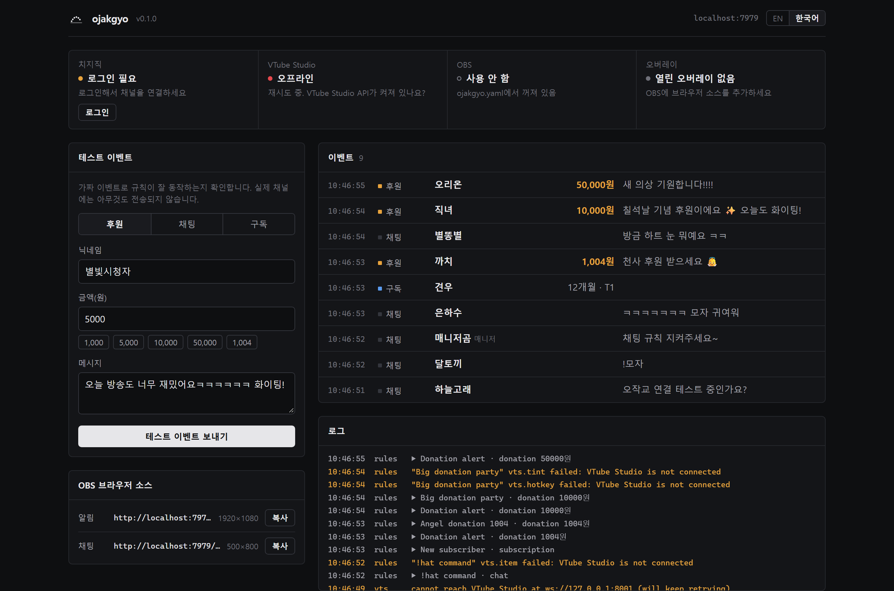
  <br/><sub><b>대시보드</b>: 연결 상태, 테스트 이벤트 입력, 브리지를 지나는 모든 이벤트를 보여 줍니다. 시스템의 밝은·어두운 테마를 따릅니다. 브라우저 언어가 한국어면 한국어로 열리고, 위쪽의 <code>EN / 한국어</code> 버튼으로 언제든 바꿀 수 있습니다.</sub>
</div>

<br/>

<table>
  <tr>
    <td width="62%" align="center">
      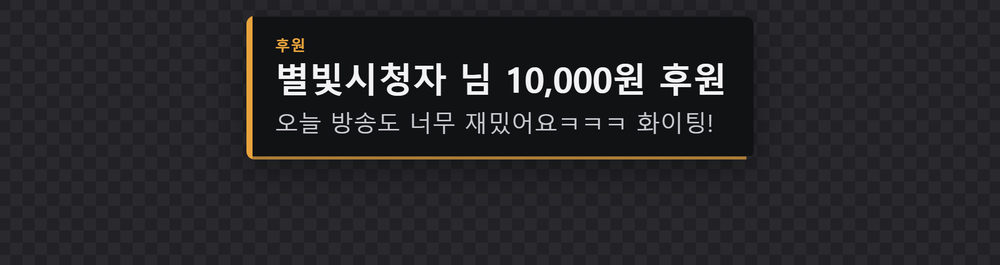
      <br/><sub><b>알림 오버레이</b>: 알림을 하나씩 띄우고 TTS로 읽어 줍니다. OBS 브라우저 소스로 추가합니다.</sub>
    </td>
    <td width="38%" align="center">
      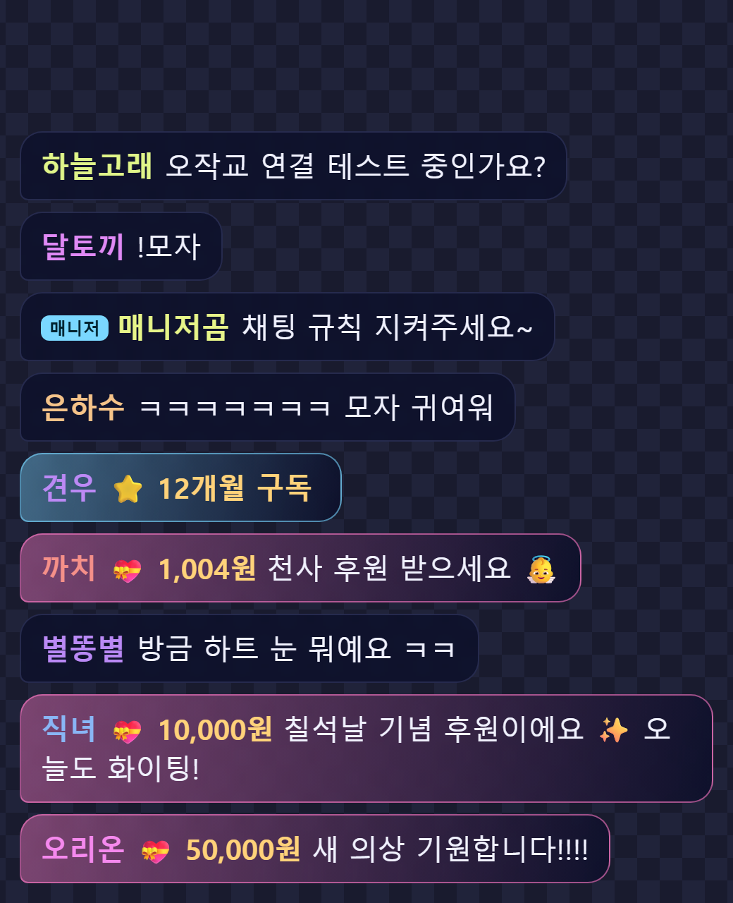
      <br/><sub><b>채팅 오버레이</b>: 투명 배경, 역할 표시, 치지직 이모티콘.</sub>
    </td>
  </tr>
  <tr>
    <td colspan="2" align="center">
      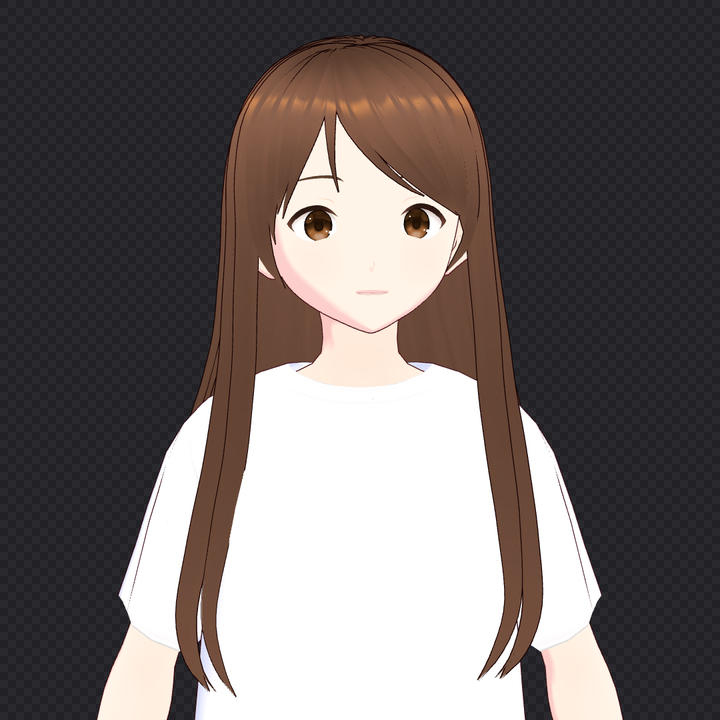
      <br/><sub><b>아바타 오버레이</b>: 투명 배경 위의 VRM 모델입니다. 숨 쉬고, 눈을 깜빡이고, 카메라를 바라보고, 후원 TTS에 맞춰 입을 움직이고, 규칙에 따라 표정을 바꿉니다. 모델: <a href="https://github.com/vrm-c/vrm-specification/tree/master/samples/VRM1_Constraint_Twist_Sample">VRM1_Constraint_Twist_Sample</a> (© pixiv Inc., VRM Public License 1.0).</sub>
    </td>
  </tr>
</table>

## 🌟 기능

<table>
  <tr>
    <td width="50%" valign="top">
      <h3>🔌 치지직 공식 Open API</h3>
      대시보드에서 OAuth로 로그인하고 <b>채팅·후원·구독</b>을 실시간 세션으로 받습니다. 토큰은 알아서 갱신됩니다. 치지직 세션 서버는 Socket.IO v2만 받기 때문에, 2017년 무렵의 의존성을 통째로 들이는 대신 최신 <code>ws</code> 위에 작은 클라이언트를 직접 만들어 넣었습니다.
    </td>
    <td width="50%" valign="top">
      <h3>🎭 VTube Studio</h3>
      <b>단축키</b> 실행, <b>표정</b> 켜고 끄기, 모델 위에 <b>아이템</b> 떨어뜨리기, 큰 후원에 아바타 <b>색 입히기</b>, TTS가 말하는 동안 입을 움직이는 <b>립싱크</b>까지 됩니다. 모두 공식 플러그인 API로 동작합니다.
    </td>
  </tr>
  <tr>
    <td valign="top">
      <h3>🎬 OBS Studio</h3>
      <b>장면</b>을 바꿨다가 자동으로 되돌리고, <b>소스</b>를 보이거나 숨기고, <b>필터</b>를 켜고 끕니다. OBS 28 이상에 기본으로 들어 있는 obs-websocket v5를 씁니다.
    </td>
    <td valign="top">
      <h3>💌 바로 쓰는 오버레이</h3>
      알림·채팅 오버레이를 <b>OBS 브라우저 소스</b>로 넣습니다. 알림은 대기열에서 하나씩 나와 겹치지 않고, 금액은 <code>10,000원</code>처럼 표시됩니다. 치지직 이모티콘을 지원하고, 소스를 새로 고쳐도 채팅이 다시 나옵니다.
    </td>
  </tr>
  <tr>
    <td valign="top">
      <h3>🗣️ 한국어에 맞춘 TTS</h3>
      OS 음성, <b>OpenAI 호환 서버</b>, 직접 만든 <b>GPT-SoVITS</b> 캐릭터 목소리로 후원을 읽어 줍니다. 읽기 전에 글을 다듬습니다: <code>ㅋㅋㅋㅋㅋㅋ</code> → <code>ㅋㅋㅋ</code>, 링크 제거, 금지어 제외.
    </td>
    <td valign="top">
      <h3>🧩 YAML이나 대시보드로 쓰는 규칙</h3>
      금액 범위, 정확한 금액(<code>1004</code>원 천사 후원 👼), 정규식 채팅 명령어, 역할 필터, 쿨다운, 시간 차를 둔 연속 동작, 다른 서비스로 보내는 웹훅을 지원합니다. <code>ojakgyo.yaml</code>을 직접 고치거나 대시보드의 규칙 편집기를 쓰면 됩니다. 편집기는 칸마다 검사한 뒤 파일에 저장하고 바로 적용합니다.
    </td>
  </tr>
  <tr>
    <td valign="top">
      <h3>🧪 테스트 이벤트</h3>
      대시보드나 CLI에서 가짜 후원·채팅·구독을 보내 <b>방송을 켜지 않고</b> 설정을 맞춥니다. 대시보드는 영어와 <b>한국어</b>를 지원합니다.
    </td>
    <td valign="top">
      <h3>🔒 내 PC에서만, 안전하게</h3>
      내 PC에서 돌고 <code>127.0.0.1</code>에만 열립니다. API 키는 직접 발급받아 쓰고, 토큰은 git에서 제외된 파일에 저장됩니다. 다른 웹사이트에서 오는 요청은 거부하므로, 아무 페이지나 내 방송에 가짜 후원을 띄울 수 없습니다.
    </td>
  </tr>
  <tr>
    <td colspan="2" valign="top">
      <h3>🧍 3D·2D 아바타 오버레이</h3>
      VTube Studio가 없어도 됩니다. <b>.vrm</b> 파일(VRoid Studio에서 내보낼 수 있습니다)을 지정하고 OBS에 <code>/overlay/avatar</code>를 추가하세요. 아바타가 가만히 숨 쉬고, 눈을 깜빡이고, 시청자를 바라봅니다. <b>후원 TTS에 맞춰 립싱크</b>하고, <code>avatar.expression</code> 동작으로 이벤트에 반응하고, <b>웹캠으로 내 얼굴을 따라 움직입니다</b>(브라우저에서 도는 MediaPipe). <a href="https://github.com/pixiv/three-vrm">three-vrm</a>으로 VRM 0.x와 1.0을 모두 지원하고, 모델에 <b>Perfect Sync</b>(ARKit 52) 표정이 있으면 그것을 씁니다. <code>ojakgyo avatar optimize</code>는 무거운 VRoid 모델을 35–60% 줄여 줍니다. <b>Inochi2D</b> 퍼핏(<code>.inp</code>, <code>.inx</code>)도 같은 브라우저 소스에서 마스크, MeshGroup, 머리카락 물리까지 그대로 움직입니다.
    </td>
  </tr>
</table>

## 🧭 동작 방식

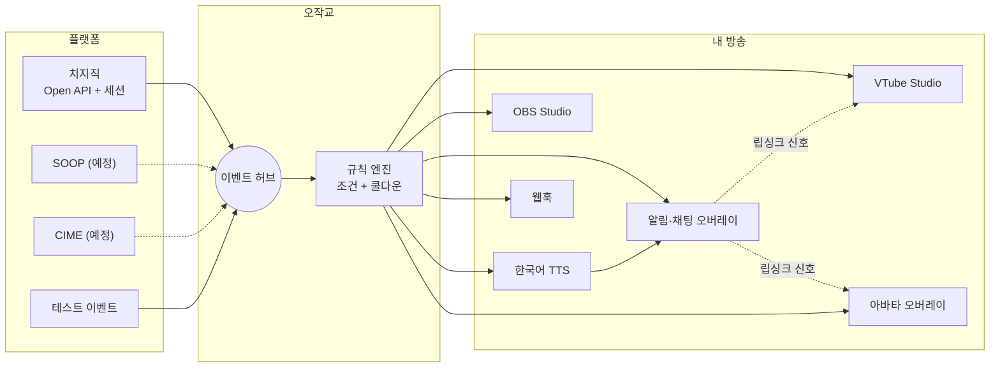

모든 커넥터는 플랫폼마다 다른 데이터를 하나의 형태(`chat`, `donation`, `subscription`)로 바꿉니다. 그래서 지금 만든 규칙은 SOOP과 CIME이 추가돼도 그대로 동작합니다.

## 🚀 빠른 시작

**필요한 것:** [Node.js 22 이상](https://nodejs.org). VTube Studio와 OBS는 선택입니다. 쓰는 것만 켜면 됩니다.

```bash
git clone https://github.com/BudongJW/ojakgyo.git
cd ojakgyo
npm install
npm run build
npm link          # 선택: ojakgyo 명령을 PATH에 추가합니다
```

원하는 폴더에서 설정 파일을 만들고 브리지를 시작합니다.

```bash
ojakgyo init      # ojakgyo.yaml과 .env를 만듭니다
ojakgyo start
```

```text
  ojakgyo v0.1.0

  Dashboard      http://localhost:7979/
  Alert overlay  http://localhost:7979/overlay/alerts  1920×1080 browser source
  Chat overlay   http://localhost:7979/overlay/chat  500×800 browser source
```

브라우저로 [http://localhost:7979](http://localhost:7979)에 들어가 **테스트 이벤트** 패널에서 후원을 보내 보세요. 바로 이벤트 목록에 나타납니다. 터미널이 편하다면 `ojakgyo simulate donation -a 10000 -m "화이팅!"`을 실행합니다.

### 📺 OBS에 오버레이 추가하기

1. **소스 → + → 브라우저**를 고르고 `http://localhost:7979/overlay/alerts`를 붙여 넣은 뒤 크기를 **1920×1080**으로 맞춥니다.
2. **OBS를 통해 오디오 제어**(Control audio via OBS)를 켭니다. TTS와 알림음이 OBS 오디오 믹서로 들어옵니다.
3. 채팅창은 `http://localhost:7979/overlay/chat`을 **500×800**으로 같은 방법으로 추가합니다.
4. 3D 아바타를 쓴다면 `http://localhost:7979/overlay/avatar`를 **1080×1080**으로 추가합니다([3D 아바타](#-3d-아바타-vrm) 참고).

> [!TIP]
> 일반 브라우저에서 오버레이 뒤에 체크무늬 배경을 보려면 주소 끝에 `?preview=1`을 붙이세요. 알림 오버레이는 `?demo=1`로 예시 알림을 반복해서 띄워 위치를 맞출 수 있고, `?position=center`나 `?position=bottom`으로 카드 위치를 옮길 수 있습니다.

### 🟢 치지직 연결하기 (약 3분)

1. [치지직 개발자 센터](https://developers.chzzk.naver.com)에서 애플리케이션을 등록합니다.<br/>
   애플리케이션 ID와 이름에는 `chzzk`, `치지직`, `naver`, `네이버`를 넣을 수 **없습니다**.
2. 로그인 리디렉션 URL을 **`http://localhost:7979/auth/chzzk/callback`** 으로 설정합니다.
3. **유저 정보 조회**, **채팅 메시지 조회**, **후원 조회**, **구독 조회** 권한(Scope)을 켭니다. `chat.send` 동작을 쓴다면 **채팅 메시지 쓰기**도 켭니다.
4. Client ID와 Secret을 `.env`에 붙여 넣습니다.
   ```dotenv
   CHZZK_CLIENT_ID=...
   CHZZK_CLIENT_SECRET=...
   ```
5. `ojakgyo start`를 실행하고 대시보드의 치지직 줄에서 **로그인**을 누릅니다.

> [!NOTE]
> 치지직은 90일 동안 API 호출이 없는 애플리케이션을 삭제합니다. 오래 쉬었다가 갑자기 로그인이 안 되면 앱이 아직 남아 있는지 확인하세요.

### 🎭 VTube Studio 연결하기

VTube Studio 설정에서 **Start API (allow plugins)** 를 켜고 포트는 `8001` 그대로 둔 뒤, 설정 파일에서 `outputs.vtubeStudio.enabled: true`로 바꿉니다. 처음 연결할 때 VTube Studio가 **Ojakgyo** 플러그인을 허용할지 묻습니다. **Allow**를 한 번 누르면 토큰이 저장되어 다음부터는 묻지 않습니다.

연결되면 대시보드에 지금 불러온 모델 이름이 나옵니다. VTube Studio가 모델을 불러올 때마다, 그리고 규칙을 저장할 때마다 오작교는 규칙에 적힌 단축키와 표정이 그 모델에 있는지 확인하고, 없는 것은 로그에 경고로 남깁니다. 대소문자만 다르면 맞는 이름도 함께 알려 줍니다. 후원이 한꺼번에 몰려도 VTube Studio의 단축키 대기열(단축키 하나당 5프레임에 1번, 최대 32개 대기)이 넘치지 않도록, 오작교가 몇 초 동안 기다렸다가 다시 보냅니다. 단축키를 버리지 않습니다.

`lipSync.enabled: true`로 두면 입 파라미터(기본값 `MouthOpen`)가 후원 TTS를 따라 움직입니다. VTube Studio는 한 파라미터를 "set" 방식으로 쓰는 플러그인을 하나만 허용합니다. 그래서 VBridger 같은 다른 플러그인이 이미 입을 움직이고 있으면, 기본값인 `lipSync.mode: auto`가 실패하는 대신 TTS 입 움직임을 그 위에 더합니다. 한 방식으로 고정하려면 `set`이나 `add`를 적으세요.

### 🎬 OBS 연결하기

OBS에서 **도구 → WebSocket 서버 설정**을 열어 서버를 켭니다. 비밀번호를 `.env`의 `OBS_PASSWORD`에 넣고, 설정 파일에서 `outputs.obs.enabled: true`로 바꿉니다.

### 🧍 3D 아바타 (VRM)

VTube Studio 없이 3D 모델로 방송하나요? 오작교가 VRM 아바타를 직접 그립니다.

1. `.vrm` 파일을 준비합니다. [VRoid Studio](https://vroid.com/studio)에서 직접 만들어 내보내거나, 아래 무료 모델로 시작하거나, 이 저장소에 든 CC0 샘플 아바타 **까치**를 쓰세요(`model: examples/avatars/kkachi/kkachi.vrm`).
2. 파일을 `ojakgyo.yaml` 옆에 두고 아바타 출력을 켭니다.
   ```yaml
   outputs:
     avatar:
       enabled: true
       model: my-avatar.vrm   # ojakgyo.yaml 기준 경로
       view: bust             # bust(머리와 어깨) 또는 full(전신)
       lipSync: true          # 후원 TTS에 맞춰 입을 움직입니다
   ```
3. OBS에 `http://localhost:7979/overlay/avatar`를 브라우저 소스로 추가합니다. 주소 끝에 `?view=full`을 붙이면 전신이 나옵니다. `?preview=1`은 일반 브라우저에서 체크무늬 배경으로 보여 주고, `?demo=1`은 위치를 맞추는 동안 표정을 돌아가며 보여 주며, `?demo=talk`는 립싱크를 확인할 때 씁니다.

**잘 맞는 무료 모델**

| 모델 | 받는 곳 | 라이선스(파일에 적힌 내용) |
| --- | --- | --- |
| **까치**, 오작교 샘플 아바타 | 이 저장소의 [examples/avatars/kkachi](examples/avatars/kkachi/README.ko.md) | CC0 |
| `VRM1_Constraint_Twist_Sample` | [vrm-c/vrm-specification](https://github.com/vrm-c/vrm-specification/tree/master/samples/VRM1_Constraint_Twist_Sample) | VRM Public License 1.0: 재배포 가능, 출처 표기 불필요 |
| `Seed-san` | [vrm-c/vrm-specification](https://github.com/vrm-c/vrm-specification/tree/master/samples/Seed-san) | VRM Public License 1.0: VirtualCast, Inc. 출처 표기 필요 |
| VRoid 공식 샘플: 센다가야 시노, 사쿠라다 후미리야, 비타, 빅토리아 루빈, 센다가야 시부, 비비 | [VRoid Hub](https://hub.vroid.com/) (로그인 필요) | CC0 |

방송에 쓰기 전에 VRM 파일 안에 적힌 라이선스를 꼭 확인하세요. 다운로드 페이지에 적힌 내용과 다를 수 있습니다.

**까치를 소개합니다.** 오작교의 자체 아바타로, 위의 CC0 VRoid 샘플 세 명에게서 노트북 CPU만으로 학습해 만들었습니다. 얼굴은 세 얼굴로 만든 얼굴 형태 공간(머리 뼈 기준으로 정렬한 PCA)의 중심이고, 색은 Lab 색공간에서 k-평균으로 나눈 색 무리별로 까치 팔레트로 옮겼습니다. 전설에서 오작교를 놓는 바로 그 새의 색입니다. 원본처럼 CC0이고, 폴더 안의 스크립트로 바이트 단위까지 똑같이 다시 만들거나 나만의 얼굴을 섞어 만들 수 있습니다. 자세한 내용은 [examples/avatars/kkachi](examples/avatars/kkachi/README.ko.md)에 있습니다.

<div align="center">
  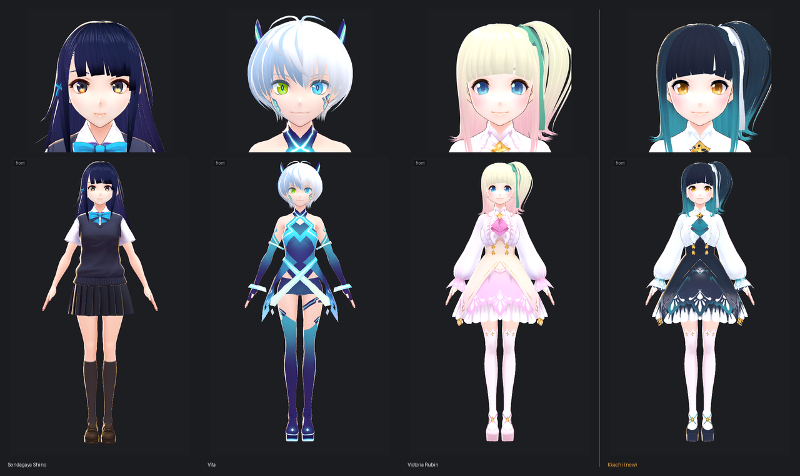
  <br/><sub>까치를 학습한 VRoid 샘플 세 명(CC0, pixiv Inc.)과 까치.</sub>
</div>

**라이선스는 오작교가 대신 읽어 줍니다.** 브리지가 시작되면 모델에 적힌 이용 조건(VRM 1.0·0.x 메타 정보, Inochi2D 퍼핏의 라이선스 주소)을 읽고, 수익 방송에 쓸 수 있는지를 대시보드의 아바타 브라우저 소스 아래에 보여 줍니다.

| 대시보드 표시 | 파일에 적힌 내용 |
| --- | --- |
| 수익 방송에 쓸 수 없음 | 비상업 전용(CC BY-NC 포함)이거나, 제작자 본인만 이 아바타로 활동할 수 있음 |
| 수익 방송 전에 조건을 확인하세요 | 따로 허락받은 사람만 쓸 수 있거나, 별도 조건 링크가 있음 |
| 파일에 이용 조건이 없음 | 이용 조건 항목이 아예 없음. 변환된 모델에 흔합니다 |
| 파일 기준 수익 방송에 쓸 수 있음 | 그 밖의 경우. 출처 표기, 재배포 금지, 수정 금지 같은 조건은 따로 안내합니다 |

설정하기 전에 `ojakgyo avatar info my-avatar.vrm`으로 파일을 미리 확인할 수 있고, `avatar optimize`도 수정을 금지한 모델이면 경고합니다. 어디까지나 파일에 적힌 내용입니다. 공식 게임 모델처럼 다른 사람의 캐릭터를 변환한 모델은 파일 내용과 상관없이 원저작자의 조건을 따릅니다.

**Perfect Sync 모델.** VRM에 ARKit 블렌드셰이프 52개("Perfect Sync", 예: `JawOpen`, `EyeBlinkLeft`)가 있으면 오버레이가 이를 알아채고, 기본 프리셋 대신 턱과 눈꺼풀 셰이프로 립싱크와 깜빡임을 합니다. 어느 방식을 골랐는지는 대시보드 로그에 나옵니다.

#### 웹캠 얼굴 트래킹

OBS 브라우저 소스는 카메라를 열 수 없습니다. 그래서 트래킹은 일반 브라우저 창에서 돌리고, 결과만 오버레이로 보냅니다.

1. Chrome이나 Edge에서 `http://localhost:7979/tracker`를 엽니다. 대시보드의 **얼굴 트래커 열기**를 눌러도 됩니다.
2. 카메라를 고르고 **시작**을 누릅니다. 처음 시작할 때 Google의 MediaPipe 얼굴 모델(약 4 MB)을 한 번 받아 `.ojakgyo/models`에 저장합니다.
3. 평소 방송하는 자세로 앉아 화면을 똑바로 보고 **지금 자세를 정면으로**를 누릅니다. 카메라가 모니터 위나 아래에 있어서 생기는 기울어짐을 없애 주고, 다음에도 기억합니다.

트래커에서 신호가 들어오면 오버레이가 바로 내 얼굴을 따라 움직이고, 트래커가 멈추면 기본 동작으로 부드럽게 돌아갑니다. Perfect Sync 모델은 52개 셰이프를 모두 쓰고, 다른 VRM은 깜빡임(눈마다 따로), 입 벌림, `ou`, `ee`, 미소를 기본 표정에 연결합니다. 규칙으로 띄운 표정이 재생되는 동안에는 규칙이 우선입니다. **거울 모드**(기본으로 켜짐)를 켜면 아바타가 거울에 비친 나처럼 움직입니다.

<div align="center">
  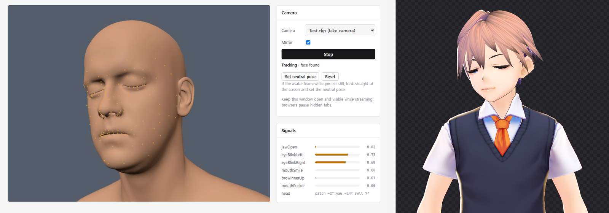
  <br/><sub>웹캠 대신 렌더링한 테스트용 머리로 확인한 화면입니다. 머리 스캔: Lee Perry-Smith(Infinite Realities, <a href="https://creativecommons.org/licenses/by/3.0/">CC BY 3.0</a>), 피부색은 직접 입혀 렌더링했습니다. 아바타: VRoid 샘플 사쿠라다 후미리야(CC0).</sub>
</div>

카메라 영상은 브라우저 탭 밖으로 나가지 않습니다. 블렌드셰이프 값과 머리 각도(수백 바이트, 초당 최대 30번)만 `localhost`의 브리지로 갑니다. 브라우저는 숨겨진 탭을 느리게 돌리므로, 방송 중에는 트래커 창을 화면에 보이게 두세요.

#### 가볍게 만들기

VRoid로 내보낸 모델은 용량 대부분이 텍스처이고, 2048² 텍스처가 여러 장인 경우가 많습니다. 방송 전에 줄여 두세요.

```bash
ojakgyo avatar optimize my-avatar.vrm            # my-avatar.optimized.vrm을 만듭니다. 텍스처는 최대 1024 px
ojakgyo avatar optimize my-avatar.vrm --max 512  # 더 작게. 사양이 낮은 PC용
```

파일 안의 이미지만 줄이고(투명도 고려), 표정, 스프링 본, MToon 재질, 휴머노이드 리그는 그대로 둡니다.

<div align="center">
  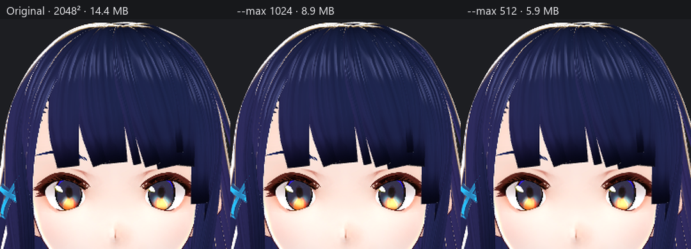
  <br/><sub>VRoid 샘플 센다가야 시노(CC0). 1024 px은 방송 화면 크기에서 원본과 구별되지 않고, 512 px은 눈의 세밀한 부분이 조금 흐려집니다.</sub>
</div>

| 모델 | 원본 | `--max 1024` | `--max 512` |
| --- | ---: | ---: | ---: |
| VRM1_Constraint_Twist_Sample | 10.3 MB | 6.6 MB | |
| 센다가야 시노 (VRoid) | 14.4 MB | 8.9 MB | 5.9 MB |
| 사쿠라다 후미리야 (VRoid) | 18.4 MB | 10.5 MB | |

규칙으로 반응하게 만들려면 이렇게 씁니다.

```yaml
rules:
  - name: 후원하면 아바타가 웃기
    on: donation
    actions:
      - type: avatar.expression
        expression: happy     # happy, angry, sad, relaxed, surprised, 사용자 정의 표정, 또는 MouthSmileLeft 같은 ARKit 이름
        duration: 3
```

> [!NOTE]
> 트래커가 없어도 아바타 오버레이는 스스로 움직이고(숨쉬기, 깜빡임, 시선) TTS에 맞춰 립싱크합니다. 몸과 손 트래킹은 지원하지 않습니다. 모델 파일은 내 디스크에서 읽어 `localhost`에만 제공하며, 어디에도 올리지 않습니다. npm 패키지에는 모델이 들어 있지 않고, 까치는 저장소의 examples 폴더에만 있습니다. 방송에 쓰기 전에 VRM에 적힌 라이선스를 확인하세요.

### 🎨 2D 아바타 (Inochi2D)

[Inochi2D](https://inochi2d.com)는 오픈소스 2D 퍼핏 형식입니다(BSD 라이선스, Live2D의 대안). 오작교에는 전용 WebGL 렌더러가 들어 있어서, 리깅한 퍼핏을 다른 앱 없이 바로 OBS에 띄울 수 있습니다.

1. Inochi Creator에서 퍼핏을 `.inp`로 내보내거나 `.inx` 프로젝트 파일을 그대로 씁니다. 먼저 시험해 보려면 [Inochi2D/example-models](https://github.com/Inochi2D/example-models)에서 **Aka**나 **Midori**를 받으세요(CC BY 4.0, seagetch 제작).
2. 아바타 출력을 그 파일로 지정합니다. 나머지는 VRM과 같습니다.
   ```yaml
   outputs:
     avatar:
       enabled: true
       model: Aka.inx         # .inp 또는 .inx. .vrm 파일은 그대로 3D 렌더러가 그립니다
       view: bust             # bust 또는 full
   ```
3. OBS에 `http://localhost:7979/overlay/avatar`를 추가합니다. 위의 주소 옵션을 그대로 쓸 수 있습니다. 리그를 점검할 때는 `?set=Head::+Roll=0.5`처럼 파라미터를 고정할 수 있습니다(`+`는 공백 대신 쓰고, 여러 개는 `|`로 잇습니다).

<div align="center">
  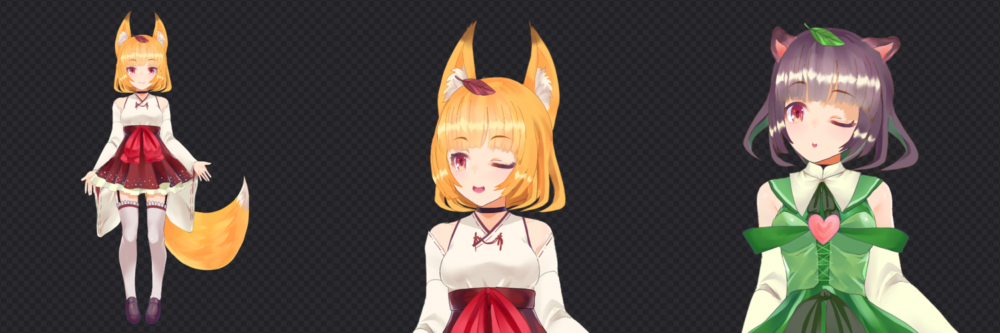
  <br/><sub>seagetch의 Inochi2D 샘플 리그 Aka와 Midori(<a href="https://creativecommons.org/licenses/by/4.0/">CC BY 4.0</a>)를 오작교로 그린 모습: 기본 자세, 그리고 트래킹으로 따라 한 고개 돌림·윙크·미소.</sub>
</div>

렌더러는 Inochi2D 0.8 런타임을 따릅니다. 파트, 마스크와 닷지 마스크, Composite, 기본 블렌드 모드(Multiply, Screen, Linear Dodge, Clip to Lower 등), MeshGroup, 머리카락·귀·옷의 SimplePhysics 진자 물리를 지원합니다. 리그에 다음 파라미터가 있으면 숨쉬기, 깜빡임, TTS 립싱크, 웹캠 트래커가 이를 움직입니다.

| 파라미터 | 움직이는 것 |
| --- | --- |
| `Head:: Yaw-Pitch`, `Head:: Roll` | 고개 돌림(트래커) 또는 가만히 있을 때의 흔들림 |
| `Body:: Yaw-Pitch`, `Body:: Roll` | 머리 움직임의 3분의 1 |
| `Eye:: Left:: Blink`, `Eye:: Right:: Blink` | 눈마다 따로(트래커) 또는 자동 깜빡임 |
| `Eye:: Left:: Move`, `Eye:: Right:: Move` | 시선(트래커) |
| `Mouth:: Shape` | 입 벌림은 턱이나 TTS, 미소는 트래커 |
| `Breath` | 숨쉬기 |

공식 샘플 리그가 쓰는 이름입니다. 이름이 다른 리그도 그려지고 물리도 돌지만, 위 신호로 움직이지는 않습니다. 2D 리그에 `avatar.expression`을 쓸 때는 `expression`에 파라미터 이름을, `weight`에 0–1 값을 넣습니다(예: `expression: "Mouth:: Shape"`). `happy`는 미소로 연결됩니다.

## 🧩 규칙

규칙은 `ojakgyo.yaml`에 적습니다. 이벤트가 조건에 **맞으면**, 적힌 동작을 위에서부터 차례로 **실행**합니다. 직접 써도 되고, 대시보드 아래쪽의 편집기를 써도 됩니다.

```yaml
rules:
  - name: 후원 알림
    on: donation
    actions:
      - type: overlay.alert
        title: "{nickname} 님 {amount}원 후원!"
        message: "{message}"
        tts: "{nickname}님, {amount}원 후원 감사합니다. {message}"

  - name: 큰 후원 파티
    on: donation
    when: { minAmount: 10000 }
    cooldown: 5
    actions:
      - type: vts.hotkey
        hotkey: Heart Eyes
      - type: vts.tint
        color: "#ff8fc7"
        duration: 4
      - type: obs.scene
        scene: 축하
        revertAfter: 8

  - name: 천사 후원
    on: donation
    when: { amounts: [1004, 10004] }
    actions:
      - type: overlay.alert
        title: "👼 천사 후원 {amount}원"
        accent: "#ffe58a"

  - name: "!모자 명령어"
    on: chat
    when: { match: "^!모자$", roles: [streamer, manager] }
    cooldown: 30
    actions:
      - type: vts.item
        file: hat.png
        duration: 20
```

규칙 이름(`name`)과 문구는 한국어로 써도 됩니다. `on`, `type` 같은 키와 값은 위처럼 영어로 씁니다.

<details>
<summary><b>📖 조건</b></summary>

| 키 | 적용 대상 | 의미 |
| --- | --- | --- |
| `minAmount` / `maxAmount` | 후원 | 금액 범위(원, 경계값 포함) |
| `amounts` | 후원 | 정확한 금액. 예: `[1004, 5252]` |
| `match` | 전체 | 메시지에 대한 정규식(대소문자 구분 없음) |
| `contains` | 전체 | 메시지에 이 글자 중 하나라도 들어 있음 |
| `roles` | 전체 | `streamer`(스트리머), `manager`(매니저), `chat_manager`(채팅 매니저), `viewer`(시청자) |
| `platforms` | 전체 | `chzzk`, `soop`, `cime`, `mock` |
| `minTier` / `minMonths` | 구독 | 구독 티어와 연속 구독 개월 수 |

규칙에 붙이는 옵션: `cooldown`(초), `stop: true`(이 규칙이 실행되면 아래 규칙은 건너뜀), `enabled: false`(끄기).

</details>

### ✏️ 대시보드에서 규칙 편집하기

`http://localhost:7979` 아래쪽의 **규칙** 패널에 모든 규칙이 실행 시점·조건과 함께 나옵니다. 규칙을 고르면 조건과 동작을 바꿀 수 있습니다. 동작 입력 칸은 브리지가 검사에 쓰는 스키마에서 만들어지므로, 화면은 항상 오작교가 받아들이는 형식과 일치합니다.

<div align="center">
  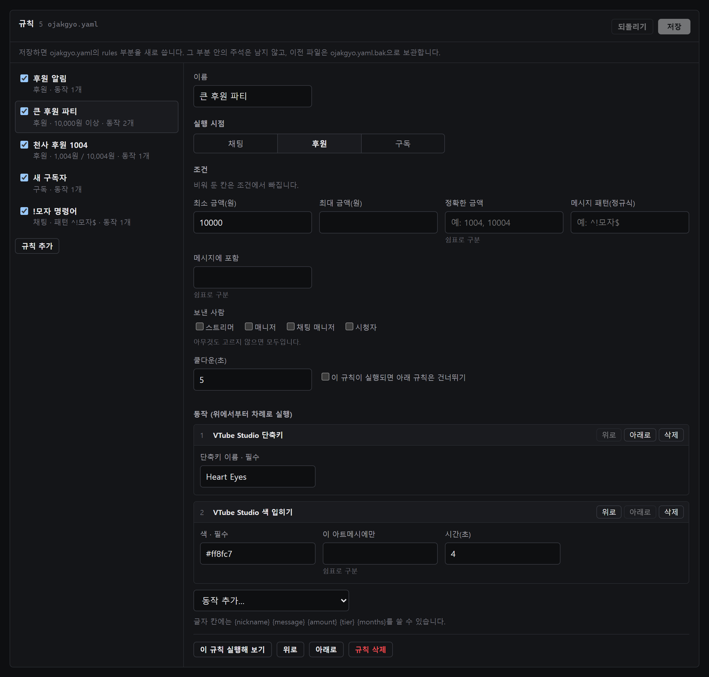
</div>

- **저장**을 누르면 먼저 모든 규칙을 검사하고 잘못된 칸을 표시합니다. 문제가 없으면 `ojakgyo.yaml`에 쓰고 재시작 없이 바로 적용합니다.
- 파일에서는 `rules:` 부분만 바뀌고 나머지는 바이트 단위로 그대로입니다. 그 부분 *안의* 주석은 남지 않으며, 이전 파일은 `ojakgyo.yaml.bak`으로 보관합니다.
- `${VAR}` 자리표시자는 자리표시자 그대로 남습니다. 편집기는 파일에 적힌 그대로를 다루므로 `.env`의 비밀값이 파일에 들어가지 않습니다.
- **이 규칙 실행해 보기**는 조건에 맞는 테스트 이벤트로 그 규칙의 동작을 한 번 실행합니다. 저장하기 전이어도 되고, 다른 규칙은 실행되지 않습니다.
- 설정 파일 없이 실행하면 패널은 읽기 전용입니다.

<details>
<summary><b>🎛️ 동작</b></summary>

| 동작 | 항목 | 하는 일 |
| --- | --- | --- |
| `overlay.alert` | `title`, `message`, `tts`, `image`, `sound`, `accent`, `duration` | 알림 카드를 띄우고, 화면에 떠 있는 동안 `tts`를 읽어 줍니다 |
| `tts.speak` | `text`, `voice` | 카드 없이 글만 읽어 줍니다 |
| `vts.hotkey` | `hotkey` | 이름이나 ID로 단축키를 실행합니다 |
| `vts.expression` | `file`, `duration`, `fadeTime` | `.exp3.json` 표정을 켜고 `duration`이 지나면 끕니다 |
| `vts.item` | `file`, `x`, `y`, `size`, `rotation`, `duration` | VTube Studio의 Items 폴더에 있는 아이템을 떨어뜨립니다 |
| `vts.tint` | `color`, `meshes`, `duration` | 모델 전체(또는 이름이 맞는 아트메시)에 색을 입힙니다 |
| `obs.scene` | `scene`, `revertAfter` | 장면을 바꾸고, 원하면 다시 되돌립니다 |
| `obs.source` | `scene`, `source`, `visible`, `duration` | 소스를 보이거나 숨깁니다 |
| `obs.filter` | `source`, `filter`, `enabled`, `duration` | 필터를 켜고 끕니다 |
| `avatar.expression` | `expression`, `weight`, `duration` | 아바타 오버레이에 VRM 표정을 띄웠다가(Inochi2D는 파라미터를 움직였다가) 서서히 되돌립니다 |
| `chat.send` | `message` | 내 치지직 채팅에 글을 올립니다(최대 100자) |
| `delay` | `seconds` | 규칙의 다음 동작 전에 기다립니다 |
| `webhook` | `url`, `method`, `body` | 이벤트(또는 템플릿으로 만든 본문)를 Discord 같은 다른 곳으로 보냅니다 |

</details>

<details>
<summary><b>🔤 템플릿 변수</b></summary>

`{nickname}` · `{message}` · `{amount}` (`10,000`) · `{amountRaw}` (`10000`) · `{tier}` · `{months}` · `{platform}` · `{type}` · `{role}`

모르는 자리표시자는 지우지 않고 그대로 둡니다. 오타가 조용히 사라지지 않고 화면에 드러나게 하기 위해서입니다.

</details>

## 🗣️ 한국어 TTS

| 방식 | 준비할 것 | 이럴 때 좋습니다 |
| --- | --- | --- |
| `browser` | 없음. 오버레이가 OS 음성을 씁니다(Windows에는 한국어 음성 *Microsoft Heami*가 들어 있습니다) | 일단 써 볼 때 |
| `openai` | OpenAI의 `POST /v1/audio/speech` 형식을 지원하는 서버. 클라우드든 로컬이든 됩니다 | 오작교는 그대로 두고 엔진만 바꾸고 싶을 때 |
| `gpt-sovits` | 실행 중인 [GPT-SoVITS](https://github.com/RVC-Boss/GPT-SoVITS) `api_v2.py`와 참조 음성 | 내 캐릭터만의 목소리 |

```yaml
outputs:
  tts:
    provider: gpt-sovits
    baseUrl: http://127.0.0.1:9880
    refAudioPath: voices/my-character.wav
    promptText: 안녕하세요, 오늘도 와주셔서 고마워요.
    promptLang: ko
```

> [!IMPORTANT]
> **수익 방송에 쓰기 전에 음성 모델의 라이선스를 확인하세요.** 2026년 11월 기준으로, 한국어를 지원하면서 상업 이용이 자유로운 공개 모델로는 Qwen3-TTS, Fun-CosyVoice3(Apache-2.0), GPT-SoVITS(MIT)가 있습니다. 인기 모델 중 여럿은 **비상업 전용**이고(예: XTTS-v2, F5-TTS 가중치, Higgs Audio v3), Kokoro처럼 한국어를 아예 지원하지 않는 모델도 있습니다.

## 🗺️ 로드맵

- [x] 치지직 Open API: OAuth, 채팅, 후원, 구독, 채팅 보내기
- [x] VTube Studio: 단축키, 표정, 아이템, 색 입히기, TTS 립싱크
- [x] OBS: 자동으로 되돌아오는 장면 전환, 소스, 필터
- [x] 알림·채팅 오버레이, 대시보드, 테스트 이벤트, CLI
- [x] 영어·한국어 대시보드
- [x] 한국어 TTS: 브라우저, OpenAI 호환, GPT-SoVITS
- [x] TTS 립싱크와 규칙 기반 표정을 지원하는 3D VRM 아바타 오버레이
- [x] Perfect Sync(ARKit 52) 표정, VRM을 가볍게 만드는 `ojakgyo avatar optimize`
- [x] 3D 아바타용 웹캠 얼굴 트래킹(MediaPipe, ARKit 호환 출력)
- [x] 2D 아바타: Inochi2D 퍼핏 오버레이
- [x] 대시보드 규칙 편집기
- [x] 한국어 문서(이 문서)
- [ ] **SOOP** 커넥터(공식 Chat SDK를 헤드리스 릴레이로 연결)
- [ ] **CIME** 커넥터
- [ ] YouTube 라이브 채팅
- [ ] 트레이 아이콘과 자동 실행을 지원하는 데스크톱 앱
- [ ] 선택형 AI 공동 진행자(로컬 LLM), AI 생성물 표시 기본 탑재

아이디어가 있다면 [이슈를 열어 주세요](https://github.com/BudongJW/ojakgyo/issues/new/choose). 한국어로 써도 됩니다. 실제로 방송하는 스트리머의 의견이 다음 작업을 정합니다.

## 🛡️ 보안과 플랫폼 정책

- **공식 API만 씁니다.** 오작교는 페이지를 스크래핑하거나 내부 엔드포인트를 호출하지 않습니다.
- **키는 직접 발급받습니다.** 스트리머마다 자기 치지직 앱을 등록하므로 플랫폼 약관 안에서 쓰고, 키도 내 것으로 남습니다.
- **비밀값은 내 PC에만 있습니다.** 토큰은 소유자만 읽을 수 있는 권한으로 `.ojakgyo/secrets.json`에 저장합니다. `.env`, `.ojakgyo/`, `ojakgyo.yaml`과 그 `.bak` 백업은 git에서 제외됩니다.
- **네트워크에 열지 않습니다.** 서버는 `127.0.0.1`에만 열리고, 다른 출처에서 온 요청을 거부하며, 시청자가 보낸 글은 HTML이 아닌 글자로만 표시합니다.

보안 취약점을 발견했다면 [SECURITY.md](SECURITY.md)를 봐 주세요.

## ❓ 자주 묻는 질문

<details>
<summary><b>GPU가 필요한가요?</b></summary>

아니요. 오작교는 이벤트를 이어 주는 브리지입니다. 웹캠 트래커는 가능하면 브라우저의 GPU를 쓰고 안 되면 CPU로 돌아갑니다. GPU가 있으면 크게 좋아지는 것은 선택 사항인 로컬 TTS 엔진(GPT-SoVITS 등)뿐입니다.
</details>

<details>
<summary><b>영어를 몰라도 쓸 수 있나요?</b></summary>

대시보드와 얼굴 트래커 화면은 한국어를 지원하고, 브라우저 언어가 한국어면 자동으로 한국어로 열립니다. 규칙도 대시보드의 편집기로 한국어 화면에서 만들 수 있습니다. 다만 터미널 출력, 로그, 설정 파일의 키와 주석은 영어입니다.
</details>

<details>
<summary><b>VTube Studio를 대신하나요? Live2D 코드가 들어 있나요?</b></summary>

아니요. Live2D 모델은 VTube Studio가 불러와 그리고, 오작교는 VTube Studio의 공개 플러그인 API로 모델을 움직입니다. Live2D Cubism 코드나 샘플 모델은 포함하지 않습니다.

3D VRM 모델은 MIT 라이선스 라이브러리인 three-vrm으로 오작교가 직접 그릴 수 있고([3D 아바타](#-3d-아바타-vrm) 참고), 2D는 공개 형식인 Inochi2D 퍼핏을 그립니다([2D 아바타](#-2d-아바타-inochi2d) 참고). 웹캠 트래커는 얼굴(표정과 고개 돌림)만 다룹니다. 손이나 전신 트래킹은 전용 트래커를 계속 쓰세요.
</details>

<details>
<summary><b>그냥 socket.io-client를 쓰면 안 되나요?</b></summary>

치지직 세션 서버는 2017년에 나온 socket.io-client 1.0.0–2.0.3만 받습니다. 그 의존성 묶음(과 오래된 `ws`)을 설치할 때마다 끌어오는 대신, 오작교는 필요한 Engine.IO v3 부분만 약 200줄로 직접 구현하고 테스트를 붙였습니다.
</details>

<details>
<summary><b>SOOP이나 트위치에서도 되나요?</b></summary>

SOOP과 CIME이 로드맵의 다음 순서입니다. 규칙은 플랫폼과 상관없이 동작하므로, 지원이 추가돼도 지금 설정을 그대로 쓸 수 있습니다.
</details>

## 🛠️ 개발

```bash
npm install
npm run dev        # tsx로 소스에서 바로 실행
npm test           # vitest: 가짜 치지직·OBS·VTube Studio 서버를 띄워 단위 테스트와 종단 간 테스트 실행
npm run typecheck
```

코드 구조는 브리지 자체를 닮았습니다. `src/connectors/`(들어오는 플랫폼), `src/core/`(이벤트, 규칙, 템플릿), `src/outputs/`(VTube Studio, OBS, TTS), `src/server/` + `web/`(대시보드와 오버레이)로 나뉩니다. 플랫폼이나 동작을 추가하는 방법은 [CONTRIBUTING.md](CONTRIBUTING.md)(영어)에 있습니다. 커밋 메시지와 코드 주석은 영어로 쓰고, 사용자에게 보이는 문구와 예시에는 한국어를 환영합니다.

## 📄 라이선스

[MIT](LICENSE) © BudongJW

Inochi2D 렌더러(`web/assets/inochi2d-core.js`, `inochi2d-gl.js`)는 [Inochi2D](https://github.com/Inochi2D/inochi2d) 런타임을 옮긴 것으로 BSD 2-Clause License(Copyright (c) 2020 Inochi2D Project)를 따릅니다. 전체 고지문은 해당 파일 맨 위에 있습니다.

<sub>오작교는 독립 오픈소스 프로젝트입니다. NAVER(치지직), SOOP, DenchiSoft(VTube Studio), OBS Project와 제휴 관계가 아니며, 이들의 보증이나 후원을 받지 않습니다. 모든 제품명과 상표는 각 소유자의 것입니다.</sub>

<div align="center">
<br/>

**같은 밤하늘 아래, 한국 버튜버를 위해 만들었습니다.** 🌙

오작교가 방송에 도움이 됐다면 ⭐를 눌러 주세요. 다른 스트리머가 오작교를 찾기 쉬워집니다.

</div>
