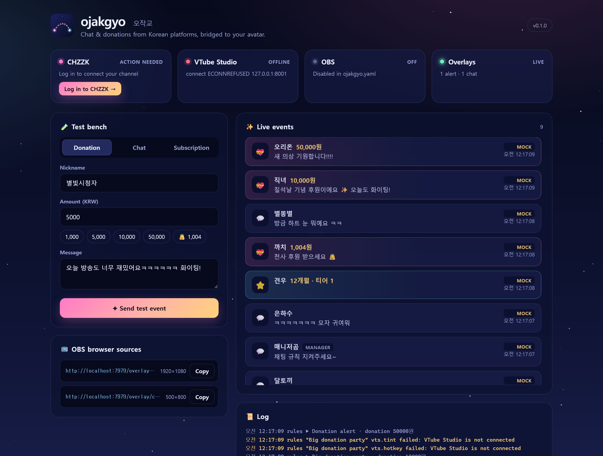
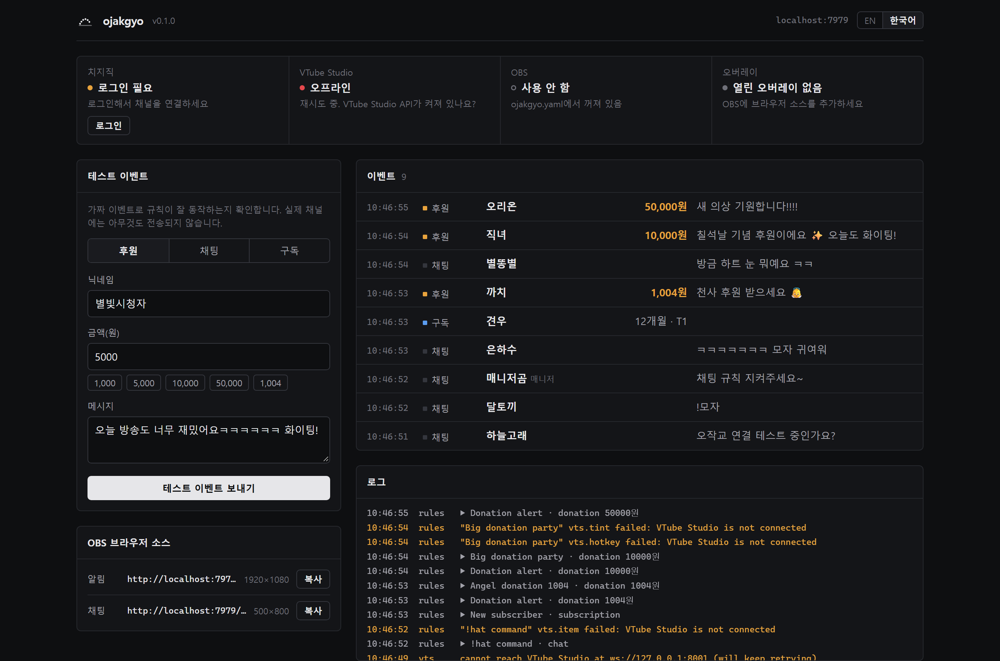
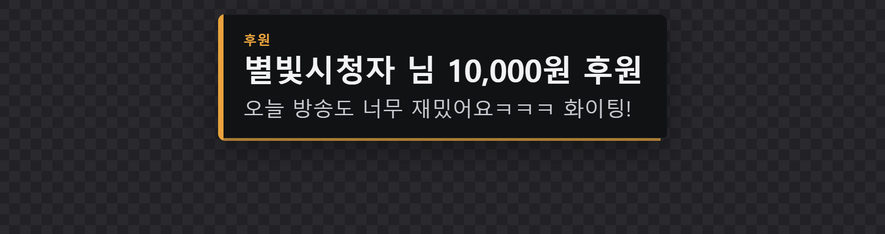
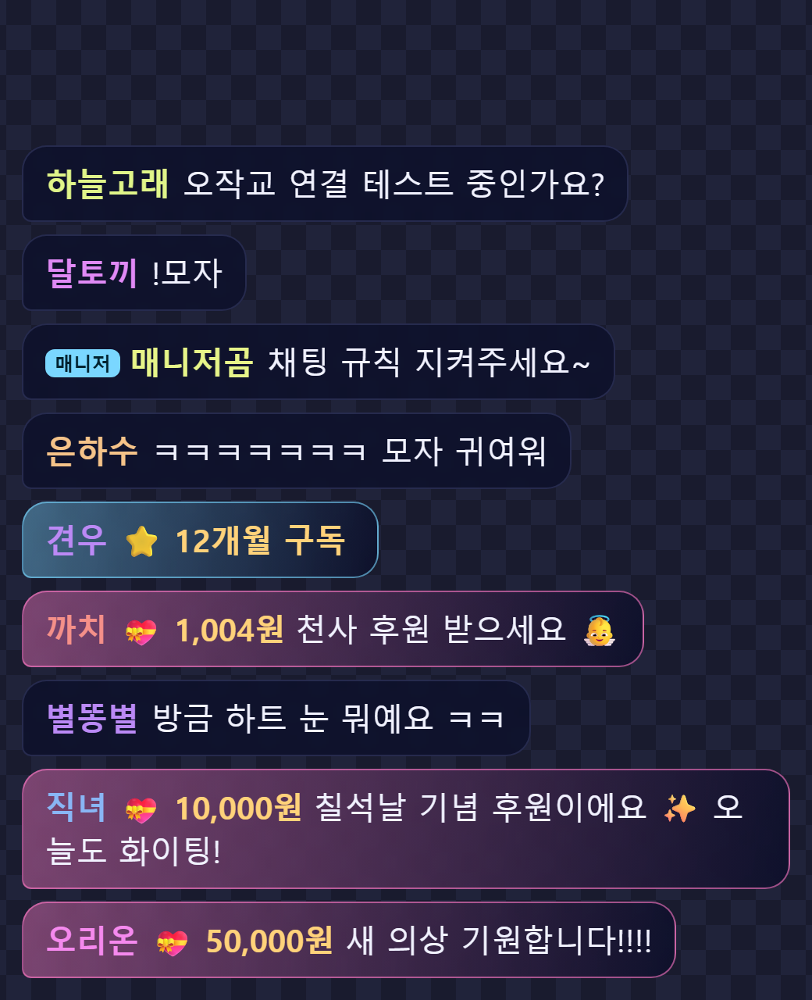
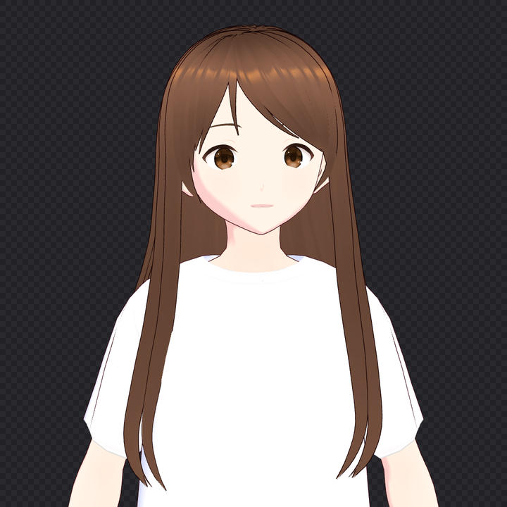
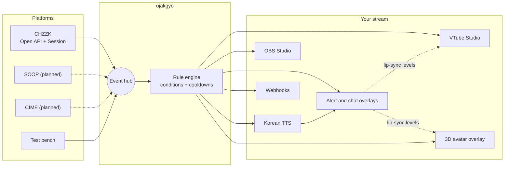
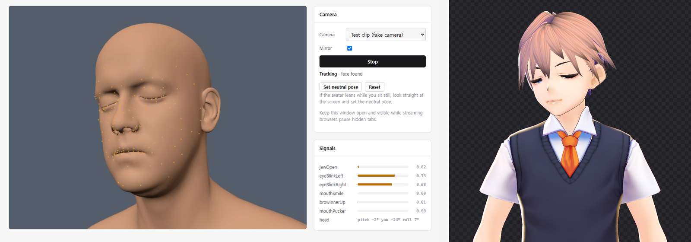
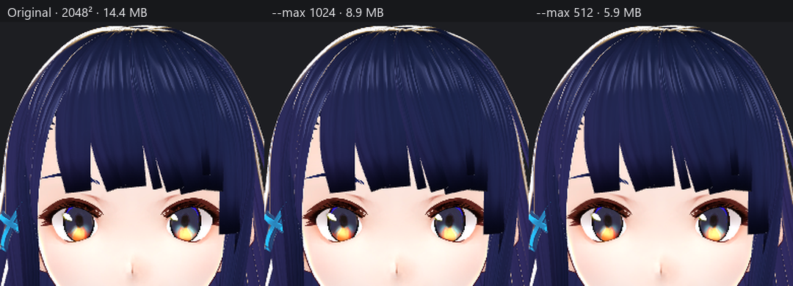

<div align="center">



<h3>Your CHZZK chat, donations and subscriptions,<br/>bridged to VTube Studio, OBS, browser overlays and Korean TTS.</h3>

<p>
  <a href="LICENSE"></a>
  
  
  <a href="CONTRIBUTING.md"></a>
</p>

<p>
  
  
  
  
  
  
</p>

<a href="#-quick-start"><b>Quick start</b></a> ·
<a href="#-features"><b>Features</b></a> ·
<a href="#-how-it-works"><b>How it works</b></a> ·
<a href="#-rules"><b>Rules</b></a> ·
<a href="#%EF%B8%8F-korean-tts"><b>Korean TTS</b></a> ·
<a href="#%EF%B8%8F-roadmap"><b>Roadmap</b></a> ·
<a href="#-faq"><b>FAQ</b></a>

</div>

<br/>

> **오작교 (ojakgyo)**: in Korean folklore, magpies and crows fly up to form a bridge across the Milky Way so that the Cowherd and the Weaver can meet on the seventh night of the seventh month.
> This project builds the same bridge between **your viewers** and **your avatar**.

## 💫 Why ojakgyo?

Streamers on Twitch and YouTube have a deep bench of viewer-interaction tools: bots, alert boxes, VTube Studio plugins that react to every cheer. Korean VTubers streaming on **CHZZK** and **SOOP** mostly do not. When we surveyed the ecosystem in November 2026, we found:

- **No open-source tool that connects CHZZK donations to VTube Studio.** Searches for VTube Studio + CHZZK integrations came back empty.
- **Multi-chat tools read Korean platforms by scraping the page**, which breaks whenever the site changes and misses rich events like donations.
- **The official APIs are finally there.** CHZZK's Open API ships OAuth and a real-time session socket for chat, donations and subscriptions.

ojakgyo is a small, local-first bridge built on those official APIs. It needs no GPU, bundles no Live2D code, and runs next to the tools you already use.

## 🎬 Preview

<div align="center">
  
  <br/><sub><b>Dashboard</b>: connection status, a form for test events, and every event that crosses the bridge. Follows your system's light or dark theme and comes in English and Korean.</sub>
</div>

<details>
<summary><b>한국어 모드</b> (Korean mode)</summary>
<br/>
<div align="center">
  
  <br/><sub>The dashboard picks Korean automatically when your browser is set to Korean. Switch any time with the <code>EN / 한국어</code> toggle in the top bar.</sub>
</div>
</details>

<br/>

<table>
  <tr>
    <td width="62%" align="center">
      
      <br/><sub><b>Alert overlay</b>: one alert at a time, read aloud by TTS. Add it as an OBS browser source.</sub>
    </td>
    <td width="38%" align="center">
      
      <br/><sub><b>Chat overlay</b>: transparent background, role labels, CHZZK emoji.</sub>
    </td>
  </tr>
  <tr>
    <td colspan="2" align="center">
      
      <br/><sub><b>Avatar overlay</b>: your VRM model on a transparent background. It breathes, blinks, looks at the camera, lip-syncs to donation TTS and changes expression from your rules. Model: <a href="https://github.com/vrm-c/vrm-specification/tree/master/samples/VRM1_Constraint_Twist_Sample">VRM1_Constraint_Twist_Sample</a> (© pixiv Inc., VRM Public License 1.0).</sub>
    </td>
  </tr>
</table>

## 🌟 Features

<table>
  <tr>
    <td width="50%" valign="top">
      <h3>🔌 Official CHZZK Open API</h3>
      OAuth login from the dashboard and a real-time session for <b>chat, donations and subscriptions</b>. Tokens refresh on their own. CHZZK's session server only speaks Socket.IO v2, so ojakgyo ships a tiny built-in client on modern <code>ws</code> instead of a 2017-era dependency tree.
    </td>
    <td width="50%" valign="top">
      <h3>🎭 VTube Studio</h3>
      Trigger <b>hotkeys</b>, toggle <b>expressions</b>, drop <b>items</b> onto your model, <b>tint</b> your avatar for big donations, and move its mouth while TTS speaks with built-in <b>lip-sync</b>. All through the official plugin API.
    </td>
  </tr>
  <tr>
    <td valign="top">
      <h3>🎬 OBS Studio</h3>
      Switch <b>scenes</b> and switch back automatically, show or hide <b>sources</b>, flip <b>filters</b>. Talks obs-websocket v5, which ships with OBS 28+.
    </td>
    <td valign="top">
      <h3>💌 Overlays that just work</h3>
      Alert and chat overlays as <b>OBS browser sources</b>: a queue so alerts never overlap, <code>10,000원</code> formatting, CHZZK emoji, and chat that comes back after you refresh the source.
    </td>
  </tr>
  <tr>
    <td valign="top">
      <h3>🗣️ Korean-first TTS</h3>
      Read donations aloud with OS voices, <b>any OpenAI-compatible server</b>, or your own <b>GPT-SoVITS</b> character voice. Cleans up the text first: <code>ㅋㅋㅋㅋㅋㅋ</code> → <code>ㅋㅋㅋ</code>, links removed, blocked words dropped.
    </td>
    <td valign="top">
      <h3>🧩 Rules in plain YAML</h3>
      Amount ranges, exact amounts (hello, <code>1004</code>원 angel donations 👼), regex chat commands, role filters, cooldowns, chained actions with delays, and webhooks to anything else.
    </td>
  </tr>
  <tr>
    <td valign="top">
      <h3>🧪 Test bench</h3>
      Fire fake donations, chats and subscriptions from the dashboard or the CLI and tune your setup <b>without going live</b>. The dashboard speaks English and <b>한국어</b>.
    </td>
    <td valign="top">
      <h3>🔒 Local-first and polite</h3>
      Runs on your PC and binds to <code>127.0.0.1</code>. You bring your own API keys, tokens stay in a git-ignored file, and the server rejects requests from other websites, so a random page can't fake a donation on your stream.
    </td>
  </tr>
  <tr>
    <td colspan="2" valign="top">
      <h3>🧍 3D VRM avatar overlay</h3>
      No VTube Studio? Point ojakgyo at a <b>.vrm</b> file (VRoid Studio exports one) and add <code>/overlay/avatar</code> to OBS. The avatar idles, blinks and looks at the viewer, <b>lip-syncs to donation TTS</b>, reacts to events with the <code>avatar.expression</code> action, and <b>follows your face from a webcam</b> (MediaPipe, in the browser). Works with VRM 0.x and 1.0 through <a href="https://github.com/pixiv/three-vrm">three-vrm</a>, uses <b>Perfect Sync</b> (ARKit 52) faces when your model has them, and <code>ojakgyo avatar optimize</code> cuts heavy VRoid exports by 35–60%.
    </td>
  </tr>
</table>

## 🧭 How it works



Every connector turns platform payloads into one shape (`chat`, `donation`, `subscription`), so a rule written today keeps working when SOOP and CIME arrive.

## 🚀 Quick start

**You need:** [Node.js 22+](https://nodejs.org). VTube Studio and OBS are optional; enable what you use.

```bash
git clone https://github.com/BudongJW/ojakgyo.git
cd ojakgyo
npm install
npm run build
npm link          # optional: adds the `ojakgyo` command to your PATH
```

Create a config in any folder you like and start the bridge:

```bash
ojakgyo init      # writes ojakgyo.yaml and .env
ojakgyo start
```

```text
  ojakgyo v0.1.0

  Dashboard      http://localhost:7979/
  Alert overlay  http://localhost:7979/overlay/alerts  1920×1080 browser source
  Chat overlay   http://localhost:7979/overlay/chat  500×800 browser source
```

Open **http://localhost:7979**, send a test donation from the test bench, and watch it arrive. Prefer the terminal? Run `ojakgyo simulate donation -a 10000 -m "화이팅!"`.

### 📺 Add the overlays to OBS

1. **Sources → + → Browser**, paste `http://localhost:7979/overlay/alerts`, size **1920×1080**.
2. Tick **Control audio via OBS** so TTS and alert sounds go through your audio mixer.
3. Repeat with `http://localhost:7979/overlay/chat` at **500×800** for the chat box.
4. Using a 3D avatar? Add `http://localhost:7979/overlay/avatar` at **1080×1080** (see [3D avatar](#-3d-avatar-vrm)).

> [!TIP]
> Append `?preview=1` to see a checkerboard behind an overlay in a normal browser. On the alert overlay, `?demo=1` loops a sample alert while you position it and `?position=center` or `?position=bottom` moves the card.

### 🟢 Connect CHZZK (about 3 minutes)

1. Open the [CHZZK Developers](https://developers.chzzk.naver.com) center and register an application.<br/>
   The app ID and name may **not** contain `chzzk`, `치지직`, `naver` or `네이버`.
2. Set the login redirect URL to **`http://localhost:7979/auth/chzzk/callback`**.
3. Enable the scopes **유저 정보 조회**, **채팅 메시지 조회**, **후원 조회** and **구독 조회** (plus **채팅 메시지 쓰기** if you use `chat.send`).
4. Paste the Client ID and Secret into `.env`:
   ```dotenv
   CHZZK_CLIENT_ID=...
   CHZZK_CLIENT_SECRET=...
   ```
5. Run `ojakgyo start` and click **Log in to CHZZK** on the dashboard.

> [!NOTE]
> CHZZK deletes applications that make no API calls for 90 days. If ojakgyo suddenly can't log in after a long break, check that your app still exists.

### 🎭 Connect VTube Studio

In VTube Studio open **Settings → Start API (allow plugins)**, keep port `8001`, and set `outputs.vtubeStudio.enabled: true`. On first connect VTube Studio asks whether to allow **Ojakgyo**. Click **Allow** once and the token is remembered.

### 🎬 Connect OBS

In OBS open **Tools → WebSocket Server Settings**, enable the server, put the password in `.env` as `OBS_PASSWORD`, and set `outputs.obs.enabled: true`.

### 🧍 3D avatar (VRM)

Streaming with a 3D model and no VTube Studio? ojakgyo can render a VRM avatar itself.

1. Get a `.vrm` file: export your own from [VRoid Studio](https://vroid.com/en/studio), or start from one of the free models below.
2. Put it next to `ojakgyo.yaml` and enable the avatar output:
   ```yaml
   outputs:
     avatar:
       enabled: true
       model: my-avatar.vrm   # relative to ojakgyo.yaml
       view: bust             # bust (head and shoulders) or full
       lipSync: true          # mouth follows donation TTS
   ```
3. Add `http://localhost:7979/overlay/avatar` to OBS as a browser source. Append `?view=full` to show the whole body, `?preview=1` to see it on a checkerboard in a normal browser, `?demo=1` to cycle expressions while you position it, or `?demo=talk` to check lip-sync.

**Free models that work well**

| Model | Where | License (as embedded in the file) |
| --- | --- | --- |
| `VRM1_Constraint_Twist_Sample` | [vrm-c/vrm-specification](https://github.com/vrm-c/vrm-specification/tree/master/samples/VRM1_Constraint_Twist_Sample) | VRM Public License 1.0: redistribution allowed, credit not required |
| `Seed-san` | [vrm-c/vrm-specification](https://github.com/vrm-c/vrm-specification/tree/master/samples/Seed-san) | VRM Public License 1.0: credit to VirtualCast, Inc. required |
| VRoid official samples: Sendagaya Shino, Sakurada Fumiriya, Vita, Victoria Rubin, Sendagaya Shibu, Vivi | [VRoid Hub](https://hub.vroid.com/) (sign-in required) | CC0 |

Always check the license stored inside a VRM before streaming with it; it can differ from what a download page says.

**Perfect Sync models.** If your VRM carries the 52 ARKit blendshapes ("Perfect Sync", e.g. `JawOpen`, `EyeBlinkLeft`), the overlay detects them and uses the jaw and eyelid shapes for lip-sync and blinking instead of the basic presets. The dashboard log tells you which mode was picked.

#### Webcam face tracking

OBS browser sources cannot open a camera, so tracking runs in a normal browser window and streams the result to the overlay.

1. Open `http://localhost:7979/tracker` in Chrome or Edge (or click **Open face tracker** on the dashboard).
2. Pick your camera and press **Start**. The first start downloads Google's MediaPipe face model (about 4 MB) once and keeps it in `.ojakgyo/models`.
3. Sit as you normally stream, look straight at the screen and press **Set neutral pose**. This cancels the tilt a camera above or below your monitor adds; it is remembered for next time.

The overlay switches to your face as soon as frames arrive and eases back to idle animation if the tracker stops. Perfect Sync models get all 52 shapes; other VRMs get blink (each eye), mouth open, `ou`, `ee` and smile mapped onto their presets. Rule-driven expressions still win while they play. **Mirror** (on by default) moves the avatar like your reflection.

<div align="center">
  
  <br/><sub>Fed with a rendered test head instead of a webcam: head scan by Lee Perry-Smith (Infinite Realities, CC BY 3.0). Avatar: VRoid sample Sakurada Fumiriya (CC0).</sub>
</div>

Camera frames never leave the browser tab. Only the blendshape values and head angles (a few hundred bytes, up to 30 times a second) go to the bridge on `localhost`. Keep the tracker window visible while streaming, because browsers throttle hidden tabs.

#### Make it load fast

VRoid exports spend most of their bytes on textures, often several 2048² sheets. Shrink them before going live:

```bash
ojakgyo avatar optimize my-avatar.vrm            # writes my-avatar.optimized.vrm, textures at most 1024 px
ojakgyo avatar optimize my-avatar.vrm --max 512  # smaller still, for slower PCs
```

Only the embedded images are resized (alpha-aware), so expressions, spring bones, MToon materials and the humanoid rig stay exactly as they were.

<div align="center">
  
  <br/><sub>VRoid sample Sendagaya Shino (CC0). At 1024 px it is indistinguishable at stream size; 512 px softens fine eye detail.</sub>
</div>

| Model | Before | `--max 1024` | `--max 512` |
| --- | ---: | ---: | ---: |
| VRM1_Constraint_Twist_Sample | 10.3 MB | 6.6 MB | |
| Sendagaya Shino (VRoid) | 14.4 MB | 8.9 MB | 5.9 MB |
| Sakurada Fumiriya (VRoid) | 18.4 MB | 10.5 MB | |

Make it react with rules:

```yaml
rules:
  - name: Avatar smiles on donations
    on: donation
    actions:
      - type: avatar.expression
        expression: happy     # happy, angry, sad, relaxed, surprised, a custom expression, or an ARKit name like MouthSmileLeft
        duration: 3
```

> [!NOTE]
> Without the tracker, the avatar overlay animates on its own (breathing, blinking, gaze) and lip-syncs to TTS. Body and hand tracking are not supported. The model file is read from your disk and served only to `localhost`. It is never uploaded, and ojakgyo does not bundle any model. Check the license embedded in your VRM before streaming with it.

## 🧩 Rules

Rules live in `ojakgyo.yaml`: **when** an event matches, **run** its actions in order.

```yaml
rules:
  - name: Donation alert
    on: donation
    actions:
      - type: overlay.alert
        title: "{nickname} 님 {amount}원 후원!"
        message: "{message}"
        tts: "{nickname}님, {amount}원 후원 감사합니다. {message}"

  - name: Big donation party
    on: donation
    when: { minAmount: 10000 }
    cooldown: 5
    actions:
      - type: vts.hotkey
        hotkey: Heart Eyes
      - type: vts.tint
        color: "#ff8fc7"
        duration: 4
      - type: obs.scene
        scene: Celebration
        revertAfter: 8

  - name: Angel donation
    on: donation
    when: { amounts: [1004, 10004] }
    actions:
      - type: overlay.alert
        title: "👼 천사 후원 {amount}원"
        accent: "#ffe58a"

  - name: "!hat command"
    on: chat
    when: { match: "^!모자$", roles: [streamer, manager] }
    cooldown: 30
    actions:
      - type: vts.item
        file: hat.png
        duration: 20
```

<details>
<summary><b>📖 Conditions</b></summary>

| Key | Applies to | Meaning |
| --- | --- | --- |
| `minAmount` / `maxAmount` | donation | Amount range in KRW (inclusive) |
| `amounts` | donation | Exact amounts, e.g. `[1004, 5252]` |
| `match` | all | Case-insensitive regular expression on the message |
| `contains` | all | Message contains any of these strings |
| `roles` | all | `streamer`, `manager`, `chat_manager`, `viewer` |
| `platforms` | all | `chzzk`, `soop`, `cime`, `mock` |
| `minTier` / `minMonths` | subscription | Subscription tier and streak |

Rule-level options: `cooldown` (seconds), `stop: true` (skip later rules when this one fires), `enabled: false`.

</details>

<details>
<summary><b>🎛️ Actions</b></summary>

| Action | Fields | What it does |
| --- | --- | --- |
| `overlay.alert` | `title`, `message`, `tts`, `image`, `sound`, `accent`, `duration` | Shows an alert card; reads `tts` aloud while it is on screen |
| `tts.speak` | `text`, `voice` | Reads text aloud without a card |
| `vts.hotkey` | `hotkey` | Triggers a hotkey by name or id |
| `vts.expression` | `file`, `duration`, `fadeTime` | Turns an `.exp3.json` expression on, then off after `duration` |
| `vts.item` | `file`, `x`, `y`, `size`, `rotation`, `duration` | Drops an item from VTube Studio's Items folder |
| `vts.tint` | `color`, `meshes`, `duration` | Tints the model (or matching ArtMeshes) |
| `obs.scene` | `scene`, `revertAfter` | Switches scene, optionally switching back |
| `obs.source` | `scene`, `source`, `visible`, `duration` | Shows or hides a source |
| `obs.filter` | `source`, `filter`, `enabled`, `duration` | Toggles a filter |
| `avatar.expression` | `expression`, `weight`, `duration` | Shows a VRM expression on the 3D avatar overlay, then fades back |
| `chat.send` | `message` | Posts to your CHZZK chat (max 100 characters) |
| `delay` | `seconds` | Waits before the next action in the rule |
| `webhook` | `url`, `method`, `body` | Sends the event (or a templated body) anywhere, e.g. Discord |

</details>

<details>
<summary><b>🔤 Template variables</b></summary>

`{nickname}` · `{message}` · `{amount}` (`10,000`) · `{amountRaw}` (`10000`) · `{tier}` · `{months}` · `{platform}` · `{type}` · `{role}`

Unknown placeholders are left untouched so typos show up on screen instead of silently disappearing.

</details>

## 🗣️ Korean TTS

| Provider | Setup | Good for |
| --- | --- | --- |
| `browser` | None. The overlay uses your OS voices (Windows ships *Microsoft Heami* for Korean) | Trying things out |
| `openai` | Any server that speaks OpenAI's `POST /v1/audio/speech`, hosted or local | Swapping engines without touching ojakgyo |
| `gpt-sovits` | A running [GPT-SoVITS](https://github.com/RVC-Boss/GPT-SoVITS) `api_v2.py` with a reference clip | Your character's own voice |

```yaml
outputs:
  tts:
    provider: gpt-sovits
    baseUrl: http://127.0.0.1:9880
    refAudioPath: voices/my-character.wav
    promptText: 안녕하세요, 오늘도 와주셔서 고마워요.
    promptLang: ko
```

> [!IMPORTANT]
> **Check the model's license before you monetize.** As of November 2026, open models with Korean support and permissive licenses include Qwen3-TTS and Fun-CosyVoice3 (Apache-2.0) and GPT-SoVITS (MIT). Several popular models are **non-commercial** (for example XTTS-v2, the F5-TTS weights and Higgs Audio v3), and some (such as Kokoro) do not support Korean at all.

## 🗺️ Roadmap

- [x] CHZZK Open API: OAuth, chat, donations, subscriptions, chat send
- [x] VTube Studio: hotkeys, expressions, items, tints, TTS lip-sync
- [x] OBS: scenes with auto-revert, sources, filters
- [x] Alert and chat overlays, dashboard, test bench, CLI
- [x] Dashboard in English and Korean
- [x] Korean TTS: browser, OpenAI-compatible, GPT-SoVITS
- [x] 3D VRM avatar overlay with TTS lip-sync and rule-driven expressions
- [x] Perfect Sync (ARKit 52) faces and `ojakgyo avatar optimize` for lighter VRMs
- [x] Webcam face tracking for the 3D avatar (MediaPipe, ARKit-compatible output)
- [ ] 2D avatars: Inochi2D puppets as an overlay
- [ ] **SOOP** connector (official Chat SDK through a headless relay)
- [ ] **CIME** connector
- [ ] YouTube Live chat
- [ ] Rule editor in the dashboard
- [ ] Desktop app with tray icon and auto-start
- [ ] Optional AI co-host (local LLM) with built-in AI-content labeling
- [ ] 한국어 문서

Have an idea? [Open an issue](https://github.com/BudongJW/ojakgyo/issues/new/choose). Feedback from working streamers shapes what comes next.

## 🛡️ Security and platform policy

- **Official APIs only.** ojakgyo never scrapes pages or calls internal endpoints.
- **Bring your own keys.** Each streamer registers their own CHZZK app, which keeps you inside the platform's terms and keeps your keys yours.
- **Secrets stay local.** Tokens are written to `.ojakgyo/secrets.json` with owner-only permissions; `.env`, `.ojakgyo/` and `ojakgyo.yaml` are git-ignored.
- **Nothing is exposed to the network.** The server binds to `127.0.0.1`, refuses requests from other origins, and renders viewer text as text, never HTML.

Found a vulnerability? See [SECURITY.md](SECURITY.md).

## ❓ FAQ

<details>
<summary><b>Do I need a GPU?</b></summary>

No. ojakgyo is an event bridge. The webcam tracker uses the browser's GPU when it can and falls back to the CPU, and only an optional local TTS engine (such as GPT-SoVITS) really benefits from a GPU.
</details>

<details>
<summary><b>Does it replace VTube Studio or ship Live2D code?</b></summary>

No. For Live2D models, VTube Studio loads and renders your model, and ojakgyo drives it through VTube Studio's public plugin API. No Live2D Cubism code or sample models are bundled.

For 3D VRM models, ojakgyo can render the avatar itself with the MIT-licensed three-vrm library (see [3D avatar](#-3d-avatar-vrm)). Its webcam tracker covers the face (expressions and head turn); for hand or full-body tracking keep using a dedicated tracker.
</details>

<details>
<summary><b>Why not just use socket.io-client?</b></summary>

CHZZK's session server only accepts socket.io-client 1.0.0–2.0.3, from 2017. Instead of pulling that tree (and its outdated `ws`) into every install, ojakgyo implements the small part of Engine.IO v3 it needs, about 200 lines with tests.
</details>

<details>
<summary><b>Will it work with SOOP or Twitch?</b></summary>

SOOP and CIME are next on the roadmap. Rules are platform-agnostic, so your config keeps working when they land.
</details>

## 🛠️ Development

```bash
npm install
npm run dev        # start from source with tsx
npm test           # vitest: unit + end-to-end tests against fake CHZZK, OBS and VTube Studio servers
npm run typecheck
```

The code is organized like the bridge itself: `src/connectors/` (platforms in), `src/core/` (events, rules, templates), `src/outputs/` (VTube Studio, OBS, TTS), `src/server/` + `web/` (dashboard and overlays). See [CONTRIBUTING.md](CONTRIBUTING.md) for how to add a platform or an action.

## 📄 License

[MIT](LICENSE) © BudongJW

<sub>ojakgyo is an independent open-source project. It is not affiliated with, endorsed by or sponsored by NAVER (CHZZK), SOOP, DenchiSoft (VTube Studio) or the OBS Project. All product names and trademarks belong to their respective owners.</sub>

<div align="center">
<br/>

**Made for Korean VTubers under the same night sky.** 🌙

If ojakgyo helps your stream, a ⭐ helps other streamers find it.

</div>
