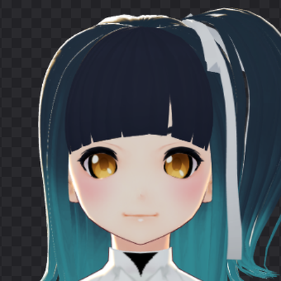
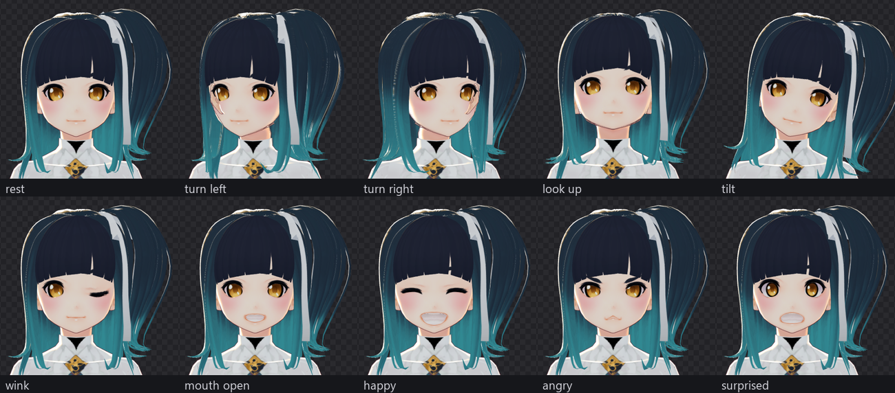
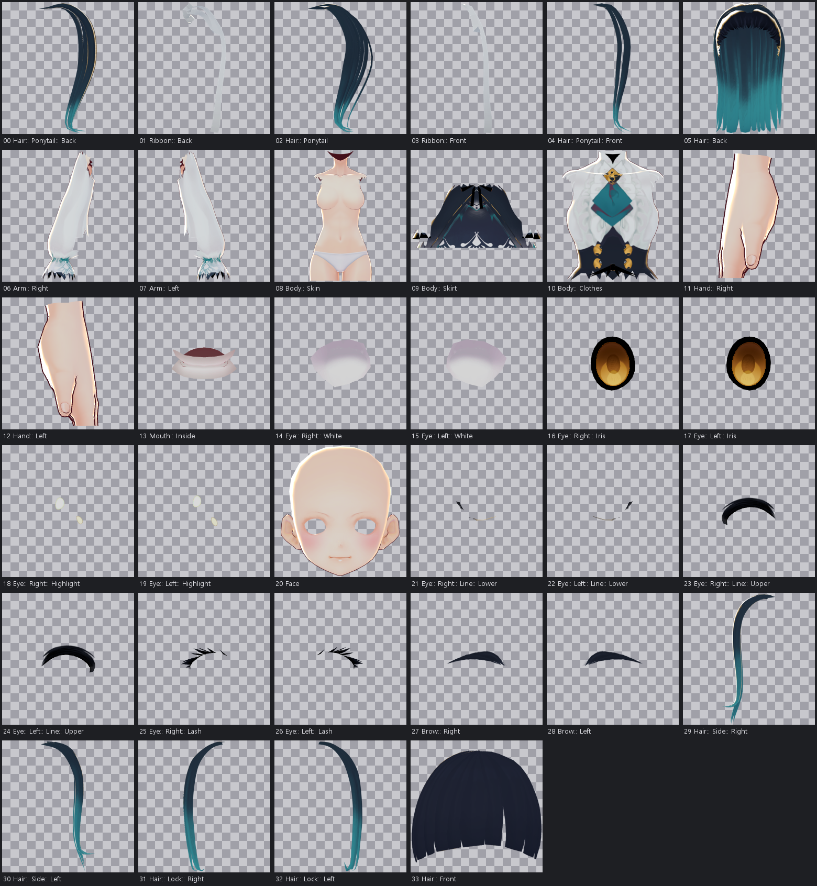

# 까치 2D (Kkachi 2D)

<sub><a href="README.md">English</a> · <b>한국어</b></sub>



오작교의 CC0 3D 아바타 [까치](../kkachi/README.ko.md)를 2D 버튜버 모델로 옮긴 것입니다. 두 가지 파일로 나옵니다.

| 파일 | 용도 |
| --- | --- |
| `kkachi2d.inp` | 리깅이 끝난 **Inochi2D 퍼핏**. 오작교 아바타 오버레이에서 바로 움직입니다. 11.5 MB |
| `kkachi2d.psd` | **Live2D용 레이어 PSD**. Cubism Editor로 직접 리깅할 사람을 위한 파츠 분리 원화입니다. 2048×2048, 레이어 34장, 7.5 MB |

둘 다 **CC0 1.0**입니다. 퍼핏 파일 안에도 `licenseURL`로 적혀 있어서, 오작교의 라이선스 확인이 "수익 방송 가능"으로 표시합니다.

## 오작교에서 쓰기

```yaml
outputs:
  avatar:
    enabled: true
    model: examples/avatars/kkachi-2d/kkachi2d.inp   # ojakgyo.yaml 기준 경로
    view: bust
```

웹캠 얼굴 트래킹, TTS 립싱크, 숨쉬기, 깜빡임, 머리카락 물리가 모두 동작합니다. 표정 파라미터 이름을 VRM 표정과 똑같이(`happy`, `angry`, `sad`, `relaxed`, `surprised`) 지어서, `avatar.expression` 규칙 하나가 3D 까치와 2D 까치 모두에서 통합니다.

```yaml
- type: avatar.expression
  expression: happy
  duration: 3
```



## 파라미터

"Left"는 **캐릭터 기준 왼쪽**(화면에서는 오른쪽)입니다. Inochi2D 샘플 리그 Aka, Midori와 같은 규칙입니다.

| 파라미터 | 범위 | 하는 일 |
| --- | --- | --- |
| `Head:: Yaw-Pitch` | x, y −1…1 | 고개 좌우 ±20°, 상하 ±10°. 키폼 15개 |
| `Head:: Roll` | −1…1 | 고개 기울이기 |
| `Body:: Yaw-Pitch` | x, y −1…1 | 몸 좌우 ±12°, 상하 ±6°. 키폼 9개 |
| `Body:: Roll` | −1…1 | 몸 기울이기 |
| `Breath` | 0…1 | 숨쉬기. 어깨와 가슴이 조금 올라갑니다 |
| `Eye:: Left:: Blink`, `Eye:: Right:: Blink` | 0…1 | 눈 감기. 0이 뜬 눈 |
| `Eye:: Left:: Move`, `Eye:: Right:: Move` | −1…1 | 눈동자 좌우 |
| `Mouth:: Shape` | x 0…1, y 0…1 | x: 0 시무룩, 0.6 보통, 1 미소. y: 0 닫힘, 1 벌림. 키폼 9개 |
| `happy`, `angry`, `sad`, `relaxed`, `surprised` | 0…1 | 얼굴 전체 표정 |
| `Hair:: … :: Physics` 7개 | 물리 | 앞머리, 좌우 옆머리와 옆 가닥, 뒷머리, 리본을 포함한 포니테일 |

## 어떻게 만들었나

손으로 그리지 않았고 AI 모델도 쓰지 않았습니다. 2D 모델은 3D 모델을 투영한 것입니다.

1. **파츠마다 한 장씩.** 3D 까치를 정면 직교 카메라로 파츠 하나씩 렌더링했습니다(34장). 그래서 앞머리에 가려진 이마, 팔에 가려진 블라우스처럼 다른 파츠에 가려진 부분까지 온전합니다. Live2D PSD 안내가 그림 작가에게 채워 두라고 요구하는 바로 그 부분입니다.
2. **키폼은 3D 움직임의 투영.** 각 파츠의 2D 메시는 3D 메시를 화면에 투영한 것입니다. 고개와 몸 돌림, 숨쉬기, 깜빡임, 입 모양, 표정, 시선 등 43가지 3D 상태에서 정점을 다시 투영해, 그 변위를 키폼으로 넣었습니다. 그래서 2D 변형이 실제 3D 모델의 움직임을 따릅니다.
3. **그리기 순서**는 파츠를 쌓은 결과를 3D 렌더와 픽셀 단위로 비교해 정했습니다. 기본 자세에서 3D와 다른 픽셀은 0.44%입니다.
4. **접힘 정리.** 고개를 돌리면 먼 쪽 가장자리의 삼각형이 뒤집히는데, 2D 메시에는 뒷면 제거가 없습니다. 그래서 그 키폼에서는 뒤집힌 부분을 가장 가까운 보이는 정점으로 접어 넣었습니다.
5. **옆머리 순서 전환.** 옆머리는 평소에 얼굴 앞에 있다가, 고개가 반대쪽으로 돌아가면 얼굴 뒤로 넘어갑니다(`zSort` 바인딩).
6. **치마.** 밑단이 소매 앞뒤를 오가서, 퍼핏에는 팔에 가려진 부분을 잘라 낸 그림을 쓰고 PSD에는 온전한 그림을 넣었습니다.
7. **머리카락 물리.** 머리카락 그룹마다 진자를 하나씩 달고, 끝으로 갈수록 크게 휘게 했습니다.

## Live2D로 리깅하기 (PSD)



- RGB 8비트, 레이어 34장, 이름이 모두 다르고 마스크나 클리핑이 없는 평범한 픽셀 레이어입니다. Live2D PSD 가져오기의 필수 조건을 지켰습니다.
- 레이어 34장은 Cubism FREE의 ArtMesh 100개 한도 안입니다. 다만 FREE는 텍스처 1장(2048 px)이라 아틀라스에서 파츠가 작아질 수 있습니다.
- VTube Studio 자동 설정이 통하도록 표준 파라미터에 연결하세요. 고개는 `ParamAngleX/Y/Z`, 눈은 `ParamEyeLOpen`/`ParamEyeROpen`(눈꺼풀은 `Face`, `Eye … Line Upper`, `Eye … Lash`), 입은 `Face`와 `Mouth Inside`에 `ParamMouthOpenY`, `ParamMouthForm`, 몸은 `ParamBodyAngleX/Y/Z`, 숨은 `ParamBreath`, 머리카락은 `ParamHairFront/Side/Back`입니다.
- `.model3.json`의 `EyeBlink`(`ParamEyeLOpen`, `ParamEyeROpen`)와 `LipSync`(`ParamMouthOpenY`) 그룹을 꼭 채우세요. 공개된 오픈 라이선스 Live2D 모델은 이 둘을 비워 두는 경우가 많습니다.

## 확인한 것과 한계

- 오작교의 Inochi2D 렌더러에서 기본 자세, 고개 상하좌우, 기울이기, 깜빡임과 윙크, 입 모양 5종, 표정 5종, 시선, 숨쉬기, 몸 돌림을 확인했습니다. 머리카락 물리는 스크립트로 고개를 흔들어 확인했습니다.
- PSD는 따로 만든 리더(34장 모두 렌더와 픽셀 단위로 같음)와 Pillow로 다시 읽어 확인했습니다.
- **Inochi Creator와 Live2D Cubism Editor에서는 열어 보지 않았습니다.**
- 고개를 위와 옆으로 동시에 끝까지 돌리면 턱 아래와 귀 근처에 작은 자국이 남습니다. 고개를 숙이면 정수리 쪽 머리카락 안쪽이 조금 보입니다. 정면 렌더에는 정수리가 없기 때문입니다.
- 조명이 그림에 구워져 있습니다.

## 다시 만들기

[`tools/`](tools)의 스크립트는 [`../kkachi/kkachi.vrm`](../kkachi/README.ko.md)에서 `kkachi2d.inp`와 `kkachi2d.psd`를 바이트 단위까지 똑같이 다시 만듭니다. 저장소의 npm 의존성, Chrome 또는 Chromium(다른 곳에 설치돼 있으면 `CHROME`으로 지정), PSD에는 NumPy와 Pillow가 있는 Python이 필요합니다.

```bash
npm install
node examples/avatars/kkachi-2d/tools/bake.mjs bake-out          # 렌더와 투영, 약 10초
node examples/avatars/kkachi-2d/tools/build.mjs bake-out examples/avatars/kkachi-2d/tools/order.json kkachi2d.inp
python examples/avatars/kkachi-2d/tools/make_psd.py bake-out examples/avatars/kkachi-2d/tools/order.json kkachi2d.psd
```

- `bake.html`에 레이어와 3D 상태 목록이 있습니다. 파츠를 다르게 나누거나 키폼을 더하려면 여기를 고치세요.
- `order-search.py bake-out`은 3D 렌더와 가장 비슷한 그리기 순서를 찾습니다.
- `read_psd.py`는 PSD를 다시 읽어 확인합니다.

## 라이선스

까치 2D(`kkachi2d.inp`, `kkachi2d.psd`, `portrait.png`)는 3D 까치와 그 원본인 VRoid 샘플처럼 [CC0 1.0](https://creativecommons.org/publicdomain/zero/1.0/deed.ko)으로 공개합니다. `tools/`의 스크립트는 오작교의 나머지 코드처럼 MIT입니다.
