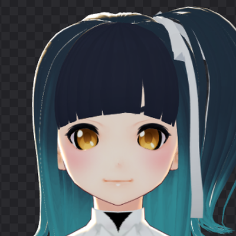
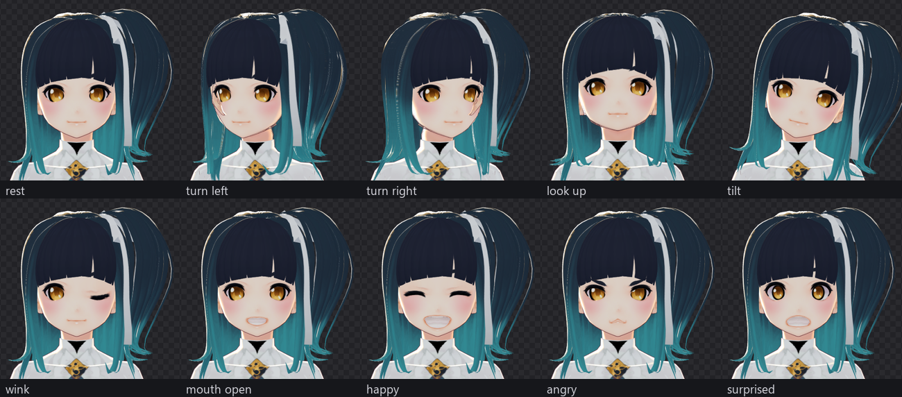
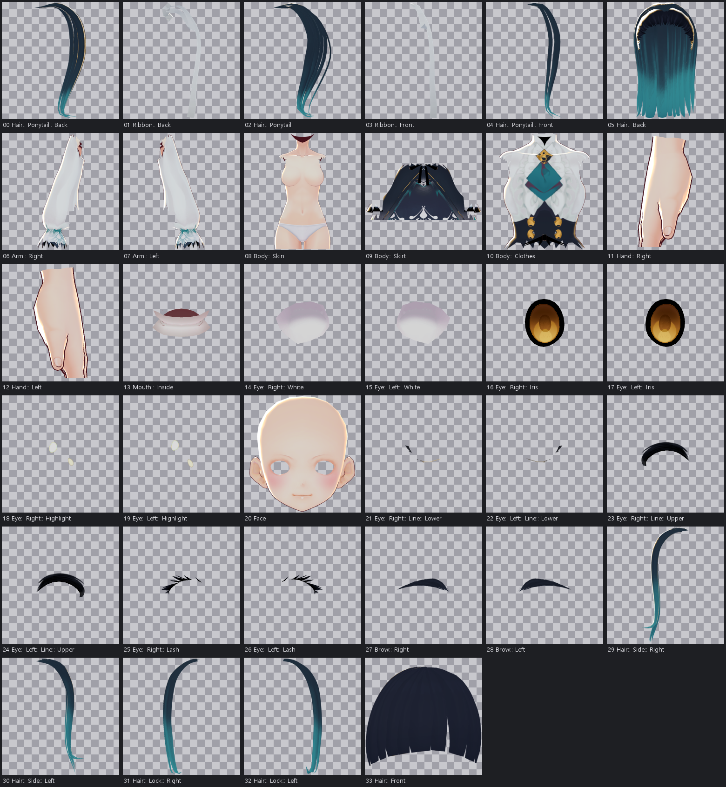

# Kkachi 2D (까치 2D)

<sub><b>English</b> · <a href="README.ko.md">한국어</a></sub>



[Kkachi](../kkachi), ojakgyo's CC0 3D avatar, turned into a 2D VTuber model. She comes in two files:

| File | What it is |
| --- | --- |
| `kkachi2d.inp` | A rigged **Inochi2D puppet**, ready for ojakgyo's avatar overlay. 11.5 MB |
| `kkachi2d.psd` | A **layered PSD for Live2D**: the parts, separated and complete, for anyone who wants to rig her in Cubism Editor. 2048×2048, 34 layers, 7.5 MB |

Both are **CC0 1.0**. The puppet carries the license in its own `licenseURL`, so ojakgyo's license check shows her as fine for monetized streams.

## Use it with ojakgyo

```yaml
outputs:
  avatar:
    enabled: true
    model: examples/avatars/kkachi-2d/kkachi2d.inp   # relative to ojakgyo.yaml
    view: bust
```

Webcam tracking, TTS lip-sync, breathing, blinking and hair physics all work. Her expression parameters share the VRM expression names (`happy`, `angry`, `sad`, `relaxed`, `surprised`), so one `avatar.expression` rule works on both the 3D and the 2D Kkachi:

```yaml
- type: avatar.expression
  expression: happy
  duration: 3
```



## Parameters

"Left" is the **character's** left (the viewer's right), as in the Inochi2D sample rigs Aka and Midori.

| Parameter | Range | What it does |
| --- | --- | --- |
| `Head:: Yaw-Pitch` | x, y −1…1 | Head turn ±20°, nod ±10°; 15 keyforms |
| `Head:: Roll` | −1…1 | Head tilt |
| `Body:: Yaw-Pitch` | x, y −1…1 | Body turn ±12°, lean ±6°; 9 keyforms |
| `Body:: Roll` | −1…1 | Body tilt |
| `Breath` | 0…1 | Shoulders and chest rise a little |
| `Eye:: Left:: Blink`, `Eye:: Right:: Blink` | 0…1 | 0 is open |
| `Eye:: Left:: Move`, `Eye:: Right:: Move` | −1…1 | Gaze left and right |
| `Mouth:: Shape` | x 0…1, y 0…1 | x: 0 sulky, 0.6 neutral, 1 smile; y: 0 closed, 1 open; 9 keyforms |
| `happy`, `angry`, `sad`, `relaxed`, `surprised` | 0…1 | Whole-face expressions |
| 7 × `Hair:: … :: Physics` | physics | Front hair, side hair and locks (each side), back hair, ponytail with its ribbon |

## How she was made

Nothing was drawn by hand and no AI model was involved: the 2D model is the 3D one, projected.

1. **One image per part.** The 3D Kkachi is rendered front-on with an orthographic camera, one part at a time (34 renders), so every part is complete, including what other parts hide: the forehead under the bangs, the blouse behind the arms. That is exactly what Live2D's PSD guidelines ask painters to fill in.
2. **Keyforms are the 3D motion, projected.** Each part's 2D mesh is its 3D mesh projected onto the canvas. The vertices are projected again in 43 posed states (head and body turns, breathing, blinks, mouth shapes, expressions, gaze), and the offsets become keyforms, so the 2D deformation follows the real 3D model.
3. **Draw order** was chosen by comparing the stacked layers with the 3D render pixel by pixel; at rest 0.44% of pixels differ.
4. **Folds are tucked away.** Turning the head flips triangles near the far edge, and a 2D mesh has no back-face culling, so in those keyforms the flipped part collapses onto the nearest visible vertex.
5. **Side hair switches sides of the face.** It sits in front of the face and drops behind it when the head turns away from it (a `zSort` binding).
6. **The skirt** hem weaves in front of and behind the sleeves, so the puppet uses a skirt image cut by the arms and the PSD keeps the whole skirt.
7. **Hair physics:** one pendulum per hair group, bending more towards the tips.

## Rigging the PSD in Live2D



- RGB, 8 bits per channel, 34 plain pixel layers with unique names and no masks or clipping: the hard requirements of Live2D's PSD import.
- 34 layers fit Cubism FREE's limit of 100 ArtMeshes; FREE also allows one 2048 px texture, so parts may be scaled down in the atlas.
- Wire the standard parameters so VTube Studio's auto-setup works: `ParamAngleX/Y/Z` for the head, `ParamEyeLOpen`/`ParamEyeROpen` for the eyes (the lids are in `Face`, `Eye … Line Upper` and `Eye … Lash`), `ParamMouthOpenY` and `ParamMouthForm` for `Face` and `Mouth Inside`, `ParamBodyAngleX/Y/Z`, `ParamBreath`, and `ParamHairFront/Side/Back`.
- Fill the `EyeBlink` (`ParamEyeLOpen`, `ParamEyeROpen`) and `LipSync` (`ParamMouthOpenY`) groups in `.model3.json`. Openly licensed Live2D models often leave them empty.

## What was checked, and the limits

- In ojakgyo's Inochi2D renderer: rest pose, head turns in every direction, tilt, blink and wink, five mouth shapes, five expressions, gaze, breathing and body turns; the hair physics was checked by swinging the head with a scripted tracker.
- The PSD was read back with an independent reader (all 34 layers pixel-identical to the renders) and with Pillow.
- **Neither Inochi Creator nor Live2D Cubism Editor was used to open the files.**
- Turning the head fully up and sideways at once leaves small marks under the jaw and near the ear, and looking down shows a little of the inside of the hair at the crown: a front-on render has no crown to show.
- The lighting is baked into the art.

## Rebuild or remix her

The scripts in [`tools/`](tools) rebuild `kkachi2d.inp` and `kkachi2d.psd` byte for byte from [`../kkachi/kkachi.vrm`](../kkachi). They need the repo's npm dependencies, Chrome or Chromium (set `CHROME` if it is somewhere unusual) and, for the PSD, Python with NumPy and Pillow.

```bash
npm install
node examples/avatars/kkachi-2d/tools/bake.mjs bake-out          # renders and projections, about 10 s
node examples/avatars/kkachi-2d/tools/build.mjs bake-out examples/avatars/kkachi-2d/tools/order.json kkachi2d.inp
python examples/avatars/kkachi-2d/tools/make_psd.py bake-out examples/avatars/kkachi-2d/tools/order.json kkachi2d.psd
```

- `bake.html` lists the layers and the posed states; change them to split parts differently or add keyforms.
- `order-search.py bake-out` searches the draw order that best matches the 3D render.
- `read_psd.py` reads a PSD back for checking.

## License

Kkachi 2D (`kkachi2d.inp`, `kkachi2d.psd`, `portrait.png`) is released under [CC0 1.0](https://creativecommons.org/publicdomain/zero/1.0/), like the 3D Kkachi and the VRoid samples she comes from. The scripts in `tools/` are MIT, like the rest of ojakgyo.
