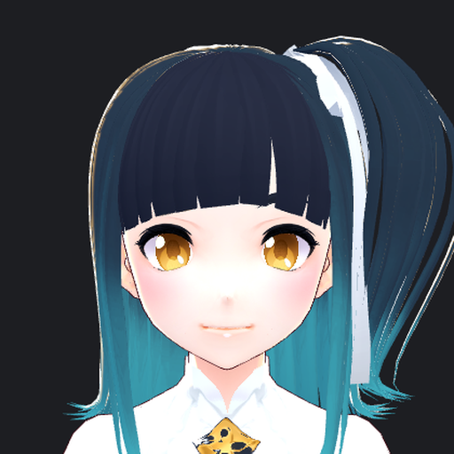
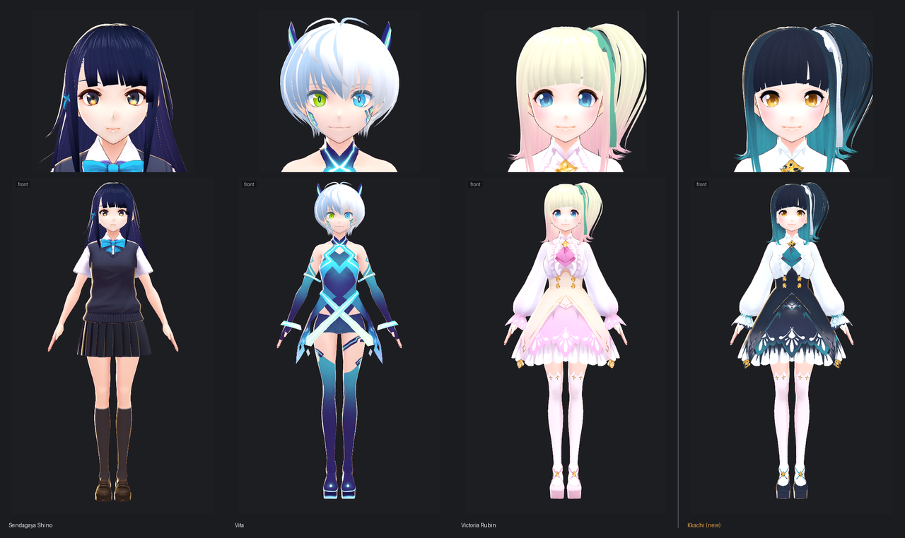

# 까치 (Kkachi)

<sub><a href="README.md">English</a> · <b>한국어</b></sub>



오작교의 샘플 아바타입니다. 이 프로젝트의 이름이 된 설화 속 다리는 까치와 까마귀가 놓습니다. 그래서 까치의 색을 입었습니다. 검정과 흰색에 청록빛 윤기, 그리고 밤하늘을 닮은 금색 눈입니다.

| | |
| --- | --- |
| 파일 | `kkachi.vrm`: VRM 0.x, 8.1 MB, 텍스처 최대 1024 px |
| 표정 | 15종: 기쁨, 화남, 슬픔, 즐거움, 놀람, 아·이·우·에·오, 깜빡임(양쪽, 왼쪽, 오른쪽), 기본, 추가 표정 |
| 물리 | 머리카락, 소매, 치마에 스프링 본 |
| 라이선스 | **CC0**. 파일 안의 라이선스 항목에도 적혀 있습니다 |
| 원본 | VRoid 샘플 캐릭터 센다가야 시노, 비타, 빅토리아 루빈(CC0, pixiv Inc.) |

이렇게 씁니다.

```yaml
outputs:
  avatar:
    enabled: true
    model: examples/avatars/kkachi/kkachi.vrm   # ojakgyo.yaml 기준 경로
```

## 어떻게 만들었나

GPU도 AI 모델도 쓰지 않았습니다. 모두 CC0 샘플 세 개에서 노트북 CPU로 학습했습니다.

1. **학습한 형태 공간에서 고른 얼굴**
   - 세 샘플은 같은 얼굴 템플릿을 씁니다. 정점 2,339개, 같은 UV, 모프 타깃 41개입니다.
   - 머리 높이가 서로 달라서(1.42~1.50 m) 각 얼굴을 자기 머리 뼈 기준으로 먼저 정렬한 뒤 PCA를 했습니다. 두 주성분이 차이를 55.5% / 44.5%로 나눕니다.
   - 까치의 얼굴은 이 공간의 중심입니다. 얼굴 앞부분은 시노·비타·빅토리아와 각각 평균 2.0 / 2.3 / 2.6 mm, 최대 7~13 mm 다릅니다.
   - 모프 타깃 41개도 같은 비율로 섞어서, 표정이 새 얼굴에 맞게 움직입니다.
   - 머리카락에 덮이는 두개골과 목 이음새는 바탕 모델의 형태를 부드럽게 유지해서, 머리카락이 그대로 맞고 목에 틈이 생기지 않습니다.
   - 눈 뼈도 눈과 함께 옮겨서, 시선이 여전히 눈동자를 중심으로 돌아갑니다.
2. **색 무리별로 옮긴 색**
   - 색이 있는 텍스처(드레스, 신발, 몸 장식, 머리카락, 홍채)마다 CIE Lab 색공간의 k-평균으로 색 무리를 학습했습니다.
   - 무리마다 까치 팔레트로 옮기고, 각 픽셀은 자기 무리 안에서의 음영을 그대로 유지합니다.
   - 같은 색이 다른 부분을 뜻할 때는 텍스처 위치로 구분했습니다. 드레스 텍스처의 위쪽 절반은 블라우스, 아래쪽 절반은 치마입니다.
   - 텍스처가 아니라 재질에 들어 있는 색(머리카락, 눈썹, 속눈썹)은 MToon 재질 값을 바꿨습니다.
3. **나머지는 빅토리아 루빈 것입니다.** 몸, 포니테일, 드레스 형태, 뼈대, 스프링 본이 그렇습니다. 실루엣은 원본과 같고, 얼굴과 색과 인상이 새것입니다.



## 다시 만들거나 내 버전 만들기

[`tools/`](tools)의 스크립트로 `kkachi.vrm`을 바이트 단위까지 똑같이 다시 만들 수 있습니다. 나만의 얼굴을 섞는 출발점으로 써도 됩니다.

1. 오작교를 빌드합니다(`npm run build`).
2. [VRoid Hub](https://hub.vroid.com/)에서 센다가야 시노, 비타, 빅토리아 루빈(CC0)을 받아 한 폴더에 넣습니다. 파일 이름에 캐릭터 이름(영문)만 들어 있으면 됩니다.
3. 다음을 실행합니다.

```bash
export VROID_SAMPLES=/path/to/vroid-samples
node examples/avatars/kkachi/tools/face-space.mjs        # 학습한 얼굴 공간과, 얼굴들이 서로 다른 부분
node examples/avatars/kkachi/tools/build.mjs --thumbnail examples/avatars/kkachi/portrait.png
npx ojakgyo avatar optimize kkachi-full.vrm -o kkachi.vrm --max 1024
node examples/avatars/kkachi/tools/face-diff.mjs kkachi.vrm
```

Windows PowerShell에서는 첫 줄 대신 `$env:VROID_SAMPLES = "C:\path\to\vroid-samples"`를 씁니다.

`--weights 0.34,0.33,0.33`은 얼굴에 시노, 비타, 빅토리아를 얼마나 섞을지 정합니다(합이 1이어야 합니다). 값을 바꾸면 다른 얼굴이 나옵니다. 팔레트는 `build.mjs`의 `P` 표와 텍스처별 규칙에서 바꿀 수 있습니다.

## 라이선스

까치(`kkachi.vrm`, `portrait.png`)는 원본 샘플과 같은 [CC0 1.0](https://creativecommons.org/publicdomain/zero/1.0/deed.ko)으로 공개합니다. 상업 이용을 포함해 허락 없이 쓰고, 고치고, 다시 배포할 수 있습니다. `tools/`의 스크립트는 오작교의 나머지 코드처럼 MIT입니다.
