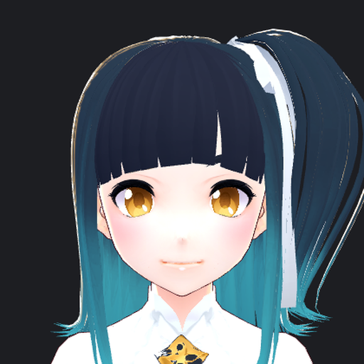
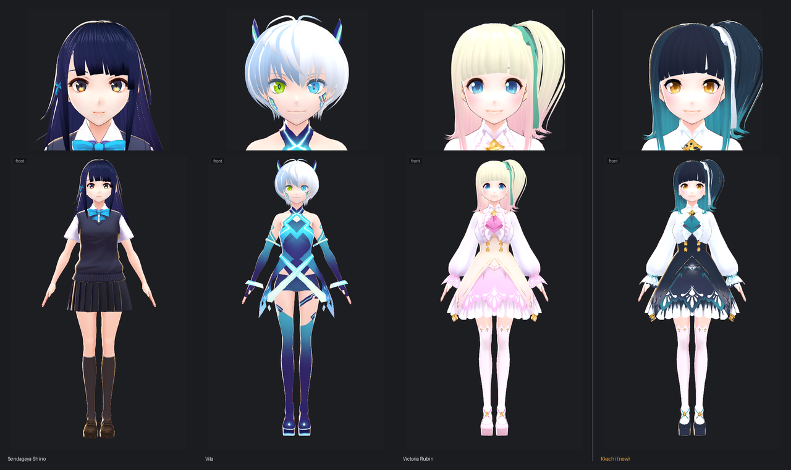

# Kkachi (까치)

<sub><b>English</b> · <a href="README.ko.md">한국어</a></sub>



ojakgyo's own sample avatar. The bridge in the Korean legend that gives this project its name is built by magpies (*kkachi*) and crows, so she wears a magpie's colours: black and white with a blue-green sheen, and gold eyes for the night sky.

| | |
| --- | --- |
| File | `kkachi.vrm`: VRM 0.x, 8.1 MB, textures at most 1024 px |
| Expressions | 15: joy, angry, sorrow, fun, surprised, a/i/u/e/o, blink (both, left, right), neutral, extra |
| Physics | spring bones on the hair, sleeves and skirt |
| License | **CC0**, also written into the file's own license fields |
| Made from | the VRoid sample characters Sendagaya Shino, Vita and Victoria Rubin (CC0, pixiv Inc.) |

There is also a 2D version, as an Inochi2D puppet and a Live2D-ready PSD: [Kkachi 2D](../kkachi-2d).

Use it with:

```yaml
outputs:
  avatar:
    enabled: true
    model: examples/avatars/kkachi/kkachi.vrm   # relative to ojakgyo.yaml
```

## How she was made

No GPU and no AI model were involved: everything was learned from the three CC0 samples on a laptop CPU.

1. **A face from a learned shape space.**
   - The three samples share one face template: 2,339 vertices, identical UVs and 41 morph targets.
   - Their heads sit at different heights (1.42 to 1.50 m), so each face is first aligned to its own head bone, then PCA runs over the aligned shapes. Two components split the variation 55.5% / 44.5%.
   - Kkachi's face is the centre of that space. Across the front of the face it sits 2.0 / 2.3 / 2.6 mm RMS from Shino / Vita / Victoria, at most 7 to 13 mm.
   - All 41 morph targets are blended the same way, so expressions fit the new face.
   - The skull under the hair and the neck seam keep the base model's shape, with a smooth falloff, so the hair still fits and the neck has no gap.
   - The eye bones move with the eyes, so gaze still turns around the eyeballs.
2. **Colours moved cluster by cluster.**
   - For each coloured texture (dress, shoes, body trim, hair, iris), k-means in CIE Lab learns its colour groups.
   - Each group is moved to the magpie palette while every pixel keeps its shading relative to its group.
   - Where the same colour means different things, the texture position decides: the dress's upper half is the blouse, the lower half the skirt.
   - Colours carried by materials rather than textures (hair, brows, lashes) are set on the MToon materials.
3. **The rest is Victoria Rubin's:** the body, the ponytail, the dress shape, the skeleton and the spring bones. The silhouette is hers; the face, colours and character are new.



## Rebuild or remix her

The scripts in [`tools/`](tools) rebuild `kkachi.vrm` byte for byte, and are a starting point for your own blend.

1. Build ojakgyo (`npm run build`).
2. Download Sendagaya Shino, Vita and Victoria Rubin from [VRoid Hub](https://hub.vroid.com/) (CC0) into one folder. Any file names work as long as they contain the character's name.
3. Run:

```bash
export VROID_SAMPLES=/path/to/vroid-samples
node examples/avatars/kkachi/tools/face-space.mjs        # the learned face space and where the faces differ
node examples/avatars/kkachi/tools/build.mjs --thumbnail examples/avatars/kkachi/portrait.png
npx ojakgyo avatar optimize kkachi-full.vrm -o kkachi.vrm --max 1024
node examples/avatars/kkachi/tools/face-diff.mjs kkachi.vrm
```

In Windows PowerShell, set the folder with `$env:VROID_SAMPLES = "C:\path\to\vroid-samples"` instead of the first line.

`--weights 0.34,0.33,0.33` sets how much of Shino, Vita and Victoria goes into the face (they must add up to 1). Change it for a different face. The palette is the `P` table and the per-texture rules in `build.mjs`.

## License

Kkachi (`kkachi.vrm`, `portrait.png`) is released under [CC0 1.0](https://creativecommons.org/publicdomain/zero/1.0/), like the samples she is made from: use, change and redistribute her, commercially too, without asking. The scripts in `tools/` are MIT, like the rest of ojakgyo.
